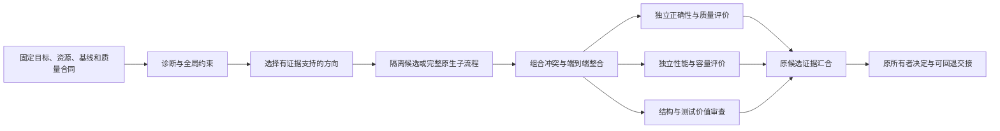

# 专家与工作流的采用矩阵

日期：2026-11-12。本文汇总[专家模板重整计划](../plans/2026-11-12-specialist-template-refresh.md)的纵向R1–R10及横向X1–X3，形成D0采用决策；[新独立事实／设计审查及D1a补核](../delivery/2026-11-12-specialist-adoption-review.md)在文档范围内Spec／Standards开放0／0。产品源码仍为`5ab6d350024de8515487d0bedb3b950be60ac867`；`9abbb6448cf42548f598e53faa342e261671b354`只交付研究与安装验收文档。本文及三份横向报告没有新增可执行模板、外部工具权限或运行器，没有安装候选或复现模型／GPU收益。

## 采用什么，什么由Ergora负责

Ergora继续作为可组合的软件交付与实验控制面：**专家定义表达能力，工作流组织责任和交接，实际工具执行任务，原所有者判断候选与批准。** 技术目录帮助检索，不应变成“一方向一个agent、一agent一个后端”的限制。一个kernel专家可以参与图、低精度和通信优化；某个通信任务也可能同时需要架构、实现、诊断与独立评价职责。

采用成熟库和原生流程时保留它们的内部职责。外层不重写Fuser的worker搜索、Forge的teacher／student、NVRx的rank monitor或原六阶段。Ergora必须补的是精确输入、全部祖先资料、有效权限、真实可用操作、总预算、原生身份／未知对账，以及候选与独立评价的交接。这些在上游没有对应接口时就是适配缺口，不能用新名字、CLI包装或一份关系图宣布解决。

下表区分四种实现形态；“可选”不意味着已经接入或已经在目标硬件运行。

|形态|定义和配置如何使用|不能省略的真实消费者|
|---|---|---|
|知识／Skill|作为精确版本的instructions／context／Skill资源，被多个专家引用。|完整文本与附件装载、来源、冲突和容量；过期开关按固定源码修正。|
|工具库／CLI|保留其原生计算、转换、诊断或确定性检查。|版本与supported operations、真实输入输出、权限／副作用、错误与结果解释。|
|单体专家|独立AgentDefinition；职能、专长、后端和资源分别配置。|每次实际调用的完整输入、独立会话、后端能力、结果和运行证据。SDK方法不自动等于单体调用。|
|完整原生流程|作为有界子模板候选，保留内部规划、worker、搜索和恢复。|覆盖每个内部模型与工具的父合同、唯一运行所有者、原生ID、状态／停止／unknown与外部评价。|

当前格式是JSON Schema约束的AgentDefinition／WorkflowDefinition及内容定址包；不新增YAML执行语言、Python表达式或按技术类分派的第二运行协议。现有`roles`与`specialties`可以表达多对多能力，同一精确定义按实例路径在多处复用。结构父链控制继承；显式依赖和具名端口控制交接，数据线不授予权限。[现有格式](../WORKFLOW_DEFINITIONS.md)；[两条分类轴](2026-11-12-optimization-taxonomy.md)。

这里的“横向”不是再加一层固定继承树：技术方向是检索与选型维度，职责是本次实例要完成的工作，后端是实际执行实现。同一定义可以声明多种职能／专长，但每个节点仍选择一个受支持的职能；调度器不能因标签增加自动获得运行能力。同一子模板在不同位置被引用时产生各自实例，分别继承自己的完整结构祖先；兄弟模板、前驱结果和数据边不产生资源继承。类继承只是帮助理解权限收窄与资料累加，实际合同仍由精确JSON定义和运行消费者实施。

## 纵向能力与可替换实现

这是采用建议表，不是已安装清单。每行的技术项仍可由多个职能协作，不直接生成一个互斥agent类；跨域控制和交接由下一节的横向报告补核。

|技术决策|优先采用／适配|条件采用／借鉴／暂缓|原件与关键限制|
|---|---|---|---|
|kernel／算子设计|先保留固定Forge campaign，适配KDA知识、现有库基线和独立正确性／测量合同。|Fuser、GEAK、AKG作为各自完整流程候选；按GPU／NPU与语言选型，不能只换名称。|[R1](2026-11-12-optimization-kernel-agents.md)：固定Forge绑定不得静默升级，exit0／内部judge不等于项目批准。|
|低精度／量化|ModelOpt工具＋官方recipe search知识；将PTQ、QAD、训练TE分开。|AutoRound按目标适配，Olive限ONNX；无可核公开代码的论文仅作研究参考。|[R2](2026-11-12-optimization-quantization-agents.md)：模型质量、训练语义、硬件和导出支持逐项验收。|
|通信与重叠|nccl-tests／NCCL诊断；需求匹配时接MSCCL++有界调优。|AutoCCL、DeepEP／HybridEP按成套栈；TACOS／MCCL不按完整通用生产搜索器接入。|[R3](2026-11-12-optimization-communication-agents.md)：微基准、估计和完整step收益分开；拓扑／版本不能混拼。|
|并行／分片|Bridge配方知识与mesh合法性，按实际框架选FSDP／CP／EP路径。|nnScaler／Galvatron-2仅按真实目标runtime适配完整系统；Aceso／Alpa借鉴搜索，不为增加agent迁移训练框架。|[R4](2026-11-12-optimization-parallelism-agents.md)、[X1](2026-11-12-horizontal-architecture-agents.md)：main／dev及动态CP边界；Auto Recipe是Skill，native plan不可互换。|
|显存／重计算／卸载|先容量分解、固定estimator与配对测量，再用原框架支持的checkpoint／offload。|PyTorch预算接口、Gemini、SmartSwap／OffMate保留原生策略循环；按设备和版本条件适配。|[R5](2026-11-12-optimization-memory-agents.md)：CPU RAM／pinned／NVMe也受预算；三种卸载接口不能混为统一开关。|
|执行图／数据调度|现有编译器／attention基线，受限capture／packing A/B。|Fuser子图搜索；强变长／PP需求才适配DynaPipe／ZeroBubble，整训练栈迁移暂缓。|[R6](2026-11-12-optimization-execution-graph-agents.md)：实际graph scope、数据mask／loss权重、backward和整步吞吐分别核。|
|诊断／测量|固定分析知识、Nsight CLI／snapshot和PyTorch原生工具；采集、离线分析、独立测量分开。|第三方Nsight MCP／HTA按需要适配；不自建CUPTI collector。|[R7](2026-11-12-optimization-profiling-agents.md)：query会写cache／可能装依赖；Preview、许可和平台能力有明确边界。|
|集群／恢复|复用已有Slurm／NeMo Run入口，NVRx先deterministic-only日志归因。|Submitit／SkyPilot按资源入口选用；含内部模型的Restart Agent须先补父合同；Agent Sessions仅作早期体验参考。|[R8](2026-11-12-optimization-cluster-agents.md)：rank生成者唯一、原ID对账、恢复owner唯一；不把requeue当模型恢复。|
|模型／配方／压缩|采用Bridge模型验证合同；有模型、数据和成套环境后，适配真实转换／评价和Minitron有限压缩流程。|FT-Agent限文本微调，逐内部会话／权限／预算未满足前完整模式unsupported；Puzzletron按部署栈准入；RL按目标框架补E2E。|[R9](2026-11-12-optimization-model-recipe-agents.md)、[X1](2026-11-12-horizontal-architecture-agents.md)：独立latest存在Python冲突；比较脚本exit0、缓存和HF导出不代表验证／训练恢复。|
|重构／开发|复用原六阶段、三个互补review职责，增加明确refactoring入口；按需用LibCST／依赖合同工具。|PR-Agent先建议性本地diff；Serena须实际工具／权限适配；Aider／Agentless不替代可信执行与批准。|[R10](2026-11-12-refactoring-workflow-agents.md)：目前只有两个正式task_type，preset名字不等于新的运行能力。|

不要求默认安装整套候选。基础安装保持轻量，工具在各自成套环境／服务中运行，项目binding选择精确位置、模型和凭据变量引用。工具缺失时在准入与页面显示具体不可用操作；不以模拟GPU、静默换框架或同名MCP掩盖差异。

## 横向研究带来的选择

三份报告在纵向研究之后补读跨域控制源码和论文；来源、固定版本、许可、读取范围及失败回执分别由各报告负责。本轮没有核到能够直接覆盖全部目标的公开通用优化agent；这不构成穷尽性不存在声明。

|横向问题|可核实现及决定|对模板和接入顺序的影响|
|---|---|---|
|[X1 架构／系统](2026-11-12-horizontal-architecture-agents.md)|区分模型结构、运行架构和代码架构。采用全局约束、动作影响与组合重验知识；ModelOpt条件适配；nnScaler／Galvatron按真实runtime适配；Aceso／Unity借鉴联合搜索。|一个架构专家可协商精度、mesh、显存、通信和图。确定性solver是工具／原生系统，不伪装成LLM专家；其配置和产物仍须有实际消费者，不能因为都是JSON就合并。|
|[X2 kernel到端到端](2026-11-12-horizontal-kernel-agents.md)|保留Forge旧pin及原teacher／student循环，作为首个kernel方向消费者；GEAK、Fuser／KernelAgent、AKG保持完整流程候选。KDA先采用任务／实验知识。|Forge仍缺全部内部会话的父资料／权限；FK_CLAUDE_BIN只是候选接缝。GEAK真实递归lane、Fuser的extractor／composer、AKG的截断／fast／compact路径须逐项准入。micro、wrapper、真实step／服务命中分开验证。|
|[X3 诊断／实验／评价](2026-11-12-horizontal-experiment-agents.md)|采用已有可信runner、评价、GEPA文本资产及MLflow投影；参数搜索优先条件适配Optuna。已有分布式试次需求再适配Tune。AIDE／FT-Agent内部会话与恢复合同未满足前完整模式unsupported。|诊断选方向、有界实验、可信测量与独立评价、原候选整合采用四项职责互补。保留原生内循环；不再建搜索器、正式实验账本或顶层调度。|

**首个通用复用消费者选原六阶段，首个kernel消费者选现有Forge，两者不是同一优先序。** 原六阶段已有可控的WorkflowInput、Executor、任务意图和批准链，适合先补父资料／权限传递及单实例引用；Forge在旧pin下仍存在reference隔离与全部资料继承冲突、CLI同进程再派agent等未覆盖路径，不能先把它标成合格嵌套流程。即使某系统更先进，没有对应真实workload、可实施权限和完整会话合同，也只保留为选项，不阻断可验收的基本能力。

## 方向与职责的多对多关系

以下分工来自R1–R10与X1–X3，不是固定必须全跑的agent名单。每项实例可以选择具备所需能力的不同后端，也可以引用同一个精确专家定义；不同实例的会话、权限和结果分别保留。各技术行的详细交叉矩阵分别见X1、X2、X3，避免在此重复一套容易漂移的能力清单。

|职责|跨越的技术决策|交付给其他职责的内容|
|---|---|---|
|全局架构／系统设计|模型语义、precision、mesh、显存、通信、图、硬件与完整目标。|固定约束、允许变量、方向选择依据、组合冲突与整合计划；代码架构设计另有interface／迁移职责。|
|局部候选生成／执行|kernel、dispatcher、packing、offload、结构压缩等一个或多个相关方向。|精确源码／配置／native plan、原始失败与候选产物，不自己批准。|
|跨域诊断|trace、memory、rank／拓扑、数据与框架调用链。|可证伪假设、关键路径证据、未解部分和下一项最小干预；最大kernel不自动等于首要瓶颈。|
|实验／搜索协调|多方向候选、代理指标、真实评价、资源时长和恢复。|冻结搜索空间／trial身份／预算、配对baseline、完整原件与归因；原生内循环不重复编排。|
|正确性／质量评价|前后向、optimizer状态、转换／恢复、模型／数据语义。|同一候选的独立结论及覆盖；必要的holdout／质量阈值在搜索前固定。|
|性能／容量评价|真实路径命中、全step或端到端吞吐、全部rank峰值与总成本。|有条件、可复核的测量结论；无收益、噪声、超时与未验分别保留。|
|结构／测试价值审查|代码架构、调用／数据所有者、兼容迁移、assertion的失败语义与成本。|可定位finding和最小修正；不以lint重报、覆盖率或投票替代行为评价。|

“不同后端”是降低共同盲点的偏好，不能证明错误统计独立；比较实际harness／模型／provider及会话。用户已授权Claude不可用时回退Codex，回退理由必须保存，不能再声称已经完成异构双后端验证。

横向协作的最小交接内容复用现有任务正文、产物和候选证据：冻结目标／baseline、允许改动、所需输入与版本、输出和实际消费者、影响资源／语义、预算、失败／无收益／unknown及重验范围。专家不能同时修改同一checkout／训练配置；原生trial号、Agent journal或MLflow run不是候选隔离。合法的单项与组合各有精确内容身份，组合须重新验受影响的数值／质量／恢复及端到端指标；需要归因时预先保留baseline、A、B、A+B，否则仅报告组合效果。代理、短训和微基准不能跨等级升级成最终收益；预算从准备前计算，并预留独立评价和清理。

## 横向流程与现有运行能力的差距

以下为建议的逻辑协作；启动前的方向选择用于冻结实际图，图中不暗示现有v2支持动态分支或任意混合角色执行。

允许并行的是不同隔离候选或只读分析；共享checkout、同一配置或同一GPU上的干扰会破坏归因。串行局部优化改变了基线，组合后的收益需要实际重测，不能把独立speedup相乘。一个完整系统若已拥有内部搜索与多worker，外层把它作为一次有界原生调用，不能再平行启动相同loop。

|当前真实所有者|已有能力|必须保留或补足|
|---|---|---|
|AgentDefinition／WorkflowDefinition|精确引用、静态嵌套、all-join、文件／Skill完整继承与权限检查。|目前resource种类只有instructions／context／skill；任意外部MCP endpoint及其工具继承没有因此实现。|
|agent_runs|叶调用及正式Executor授权的workspace调用，快照／task-mcp／结果／进程归属。|run-input不运行前驱／端口；task-mcp只暴露固定scope的list/read，不是任意外部工具代理。|
|StageDAG／WorkDelivery|正式work／review阶段的冻结图投影。|不是混合职能通用图运行器，不把新planner／native节点塞入原implementer叶。|
|WorkflowInput／原Temporal|原六阶段、计划批准、任务／运行及候选、原意图和unknown恢复。|六阶段本身还不能作为任意工作流的真实native子节点调用。首个运行补足必须沿此owner。|
|kernel|固定Forge prepare／run／status与原campaign／unknown。|没有自动满足内部teacher／student全部父资料、父权限和完整取消；不要将native_finished映射成采用。|
|evaluation／optimization／skills|固定评价集、GEPA有界Skill候选和显式采用。|这是Skill优化，不是任意训练／拓扑搜索引擎；复用其评价与采用语义，不复制成第二正式账本。|
|原训练runner／perfctl／MLflow|按精确实验checkout、运行、归档、配对比较及可选跟踪投影。|参考实现283文件保持冻结；新行为放在活跃所有者而非改冻结副本。MLflow不接管正式状态，性能比较器的多重搜索／可选停止等限制继续显示。|

上述事实见[当前架构](../architecture/current.md)、[本片源码核对](../delivery/2026-11-12-specialist-template-refresh.md#d0前置已核产品调用面)及R10；源码与旧研究的“当前”不能互相替代。

## D1–D3实施顺序与验收拆分

以下D0采用决策及D1a明细已完成独立设计审查；每片实现前再记录实际文件和最小验证，不将研究建议直接变成产品支持矩阵。接口由真实消费者决定，不先建立能接受任意命令的通用插件框架。

|优先级／候选片|具体出口|不能借此关闭|
|---|---|---|
|P0 D1 原生流程合同与首个六阶段消费者|冻结一个父模板下的一个native六阶段实例；沿原任务意图和Temporal唯一启动、原ID观察／取消／unknown；inventory、plan、work／review及内部模型的父材料和权限实际可核。先支持单实例和原内部串行／并行范围。|任意混合图、多个并行原生流程、Forge或训练自动实验；schema新增本身不算完成。|
|P0 现有模板真实入口|给refactoring明确行为保持／迁移输入，映射已有task_type；训练仍区分只读提案、工具分析、实验执行和独立验收。|新名字不新增正式task_type或已经跑过的能力。|
|P1 有证据的诊断与baseline工具消费者|离线报告／固定日志可在CPU验证；工具精确版本、受控派生目录／cache、解析状态与原件可核；训练侧按已有框架逐项接真实A/B。|离线分析不等于GPU采集、加速或集群容错。|
|P1 D2 版本化专家与方向子模板|按能力与职责复用专家；先更新跨域架构、诊断／实验和互补审查的只读资料，接可满足父合同的单叶／工具。Forge作为首个kernel方向另片准入，完整上游流程逐接口验收；旧根／旧任务保持。|描述、Skill清单或原生judge不等于真实子流程运行通过。|
|P1 最小真实实验与候选评价|原实验／进程所有者执行选定workload，冻结baseline／candidate／阈值，保存trial与原生身份、失败与no_gain；有实际参数搜索消费者时先接有界Optuna建议，另选稳定版本。预算覆盖准备和内部重试，独立评价决定下一步。|CPU／合成响应不能证明GPU收益、训练质量或多节点恢复；不直接安装研究dev快照，不把ask/tell当外部job恢复。|
|P2 外部工具与更多原生系统|按项目真实需求增加MCP／工具合同或Fuser／GEAK／ModelOpt等原生流程的传递与恢复适配；所有内部实际模型会话可核。|不以一个共享MCP连接或壳脚本宣称全部后端兼容。|
|P2 图形配置与使用旅程|现有画布选择精确专家／子模板／实际工具，显示支持操作与拒绝原因；发布／preview／grant仍走同一合同，CLI先有实际消费者。|画布可连线不等于真实执行已支持该组合。|

每个产品片分别记录基线、实际验证与未验范围；完成后用本项目审查模板及fresh-context独立评审，处理finding后再普通推送、核自己的必要CI。当前仅文档研究，无需重复未变化产品的旧CI或为可逆文字修改新增测试。横向报告与D0终核将决定哪些片可合并、应进一步拆分或暂缓。

D1按以下依赖分片，不在一次改动中同时引入schema、所有后端、任意图调度和GPU实验：

|片|可独立审查的出口|后续依赖|
|---|---|---|
|D1a 当前六阶段父合同与能力核对|固定一个真实父模板／任务消费者，列清inventory、plan、work、review、可信integrate／verify的材料和执行权限；决定实际输入版本与唯一启动方式。列出缺口、旧对象保持和拒绝条件；[源码明细与实施计划](../plans/2026-11-12-six-stage-native-consumer.md)。|设计出口；静态图和现有单叶不作为执行通过。|
|D1b 全阶段材料／权限消费者|在原WorkflowInput／Executor等实际所有者中补齐首个消费者需要的完整父资料、实际后端准入及预算约束；外部输入、容量／冲突拒绝有行为证据。无模型的确定性进程消费核定合同，不要求虚构“读Skill会话”。|原正式六阶段仍可独立运行；旧版本和283冻结保持。|
|D1c 单个可引用六阶段实例|不可变调用包由原创建／提交意图唯一消费，返回原task／run及候选／证据；原ID重复观察、请求丢失／unknown对账、批准与取消语义可核。父节点只投影原权威。|只支持已验的单实例消费者；共享可写workspace递归调用拒绝，多实例与远端留后续。|
|D1d 实际旅程与交付|在可用环境中沿真实CLI完成对应任务、计划批准、执行、候选／evidence及原ID恢复；核内部每次调用的完整材料与清理，运行自身审查和新独立两轴，正常提交／推送及必要CI。|仅实际完成的范围可称可执行六阶段子模板；缺少外部服务权限时保留明确未验出口。|

D2入口与资料可在D1设计后分开实现，但完整模板执行依赖D1，不混称完成。优化模板先组织“全局约束／诊断→选方向→独立整合评价”，重构模板沿原六阶段组织定位、批准迁移、实现与结构／正确性／测试价值审查；两者复用精确专家，不要求每个方向都启全部职责。外部MCP先有实际操作消费者与权限限制，再扩定义合同及GUI；不添加无人消费的endpoint清单。
