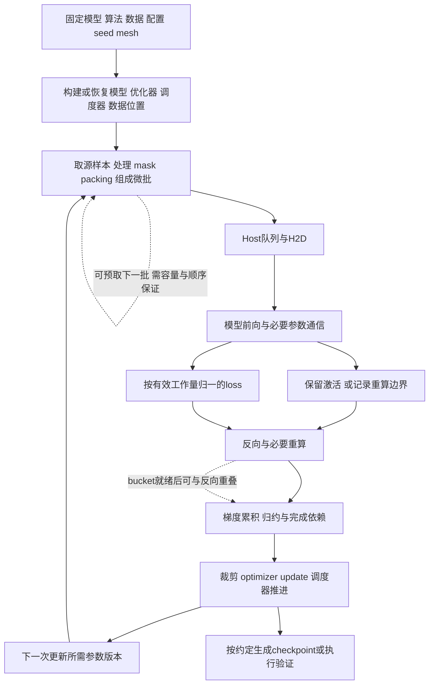
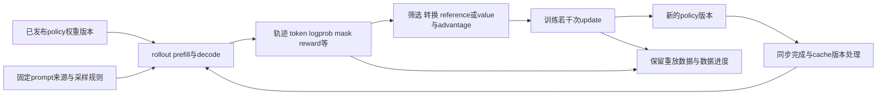

# 循环训练优化与可替换组件的架构依据

核对日期：2026-11-14 至 15。服务于 [Q 计划](../plans/2026-11-15-domain-review-optimization-quality.md) 的 Q3–Q6。仓库读取基线为 `871cc4b6b2c21420307a002bf5b983707720fe90`；当前计划及并行研究是本轮文档工作，不计作产品能力。本文仅做公开资料与源码只读研究，未安装框架、执行第三方代码、调用模型、读取用户密钥、运行训练／GPU／profiler或复现论文结果。

**建议在原训练 owner 上增加“完整流程图与生命周期 → 可比基线 → 按瓶颈选方向 → 局部候选 → 系统复测 → 下一轮”的交接合同；先用现有提案叶人工走通，再考虑有界自动循环。** kernel 保留为一种可选干预。训练框架负责张量、并行、优化器与 checkpoint；Ergora 负责精确输入、权限、原实验身份、证据和明确采用，不能把生产 trainer 搬入控制面。此分工与 Bridge 的证据门控流程、TorchTitan 的训练组件分工和本仓库原训练入口相符。[B1][T1][E1]

## 已有研究与实际产品边界

本轮复读 [R7 测量](2026-11-12-optimization-profiling-agents.md)、[R9 模型配方](2026-11-12-optimization-model-recipe-agents.md)、[R10 工程重构](2026-11-12-refactoring-workflow-agents.md)、[X1 系统架构](2026-11-12-horizontal-architecture-agents.md)、[X3 实验评价](2026-11-12-horizontal-experiment-agents.md)和 [11-14 工程 Skill](2026-11-14-local-engineering-skills.md)。这些报告已经研究独立 oracle、有效工作量、profile 扰动、预算／恢复、Optuna／Tune／MLflow、六阶段和测试价值；本轮不重新安装、引入第二账本或重复工具百科。新增依据集中于训练完整流程、状态生命周期、实际组件接缝及跨轮瓶颈迁移。[E2]

固定基线的 `training-optimization-v2` 是 `proposal-leaves`，根节点依赖为 `analysis → kernel → measurement`；独立方向的说明也明确每次只运行选定只读叶，前驱结果由操作者完整传入。`training.py` 已提供 baseline／runner／实验准备、提交、观察、取消与证据操作；手册说明实际计算仍逐精确 manifest 显式 `run-local`，没有常驻训练队列消费者。因此“取消总模板必经 kernel”“跨轮原件关联”“自动循环”分别是不同增量，当前不能写成已经具备。[E8][E3][E1][E4]

## 一手证据支持什么流程

|来源与实际读取范围|可借鉴的事实|适用边界|
|---|---|---|
|Bridge 官方 Skills 索引和固定 MoE workflow 全文|索引是操作指南／知识卡；workflow 给出 `freeze → fit → scale → profile → retune → validate`，区分 training-equivalent 与 benchmark-only，按 memory／communication／compute／host-launch 证据选候选，要求实际后端命中及未 profile 稳态计时。[B0][B1]|MoE 配方的具体 TP／EP、步数、窗口和 BF16 起点是该栈建议，不能变成所有任务的固定参数。fit／scale 也应有原始记录；“先 profile”不要求 OOM 的模型先跑完正式吞吐基准。|
|PyTorch profiler、CUDA、memory、Timer 源码／官方文档源|GPU 执行异步；准确计时需适当完成边界。shape／stack tracing 有额外成本，`record_shapes=True` 还会持有张量引用；profiler 有 wait／warmup／active 周期。Timer 为微基准处理 warmup、同步和重复。[P1][P2][P3][P4]|profile 用于解释，正式延迟／吞吐另用匹配的未插桩运行。单进程 Timer 不代替分布式 global completion 或 serving 请求基准。|
|TorchTitan 当前固定源码的 Trainer／TrainingEngine、组件与配置文档|Trainer 拥有输入、验证和报告策略，TrainingEngine 拥有执行、优化、checkpoint、profiling；微批组汇入一次 optimizer update；配置可显式构造与替换组件。[T1][T2][T3]|这是生产训练代码内的职责拆分，不是让 Ergora 增加一个 TrainingEngine。当前源码持续演进，不能把论文时期接口或旧 `TrainSpec` 路径套到本次快照。|
|slime 固定 `train.py`、rollout manager、customization 与 loss|训练和 rollout 之间显式传数据／同步权重；生成、奖励、数据源、loss 等有不同粒度的函数扩展点；checkpoint、runtime training completion 和恢复后权重就绪是不同事件。[S1][S2][S3][S4]|后训练先识别算法和同步／异步部署；不能把 rollout 生成耗时当纯 pretraining step，也不能忽略权重版本、样本筛选和 off-policy 语义。|
|SGLang scheduler、prefix cache 与 weight updater 的指定函数|scheduler 明确分接收、选批、执行、结果处理，另有 CPU/GPU overlap loop；cache 区分匹配、锁引用和驱逐；更新权重后旧 cache 的处理有专门失败语义。[G1][G2][G3]|用于理解 rollout／推理子系统的依赖和驻留；不能因此声明整份 scheduler 是小接口，或把它的全部能力／状态机搬到 Ergora。|

论文与本轮源码快照分开使用：TorchTitan 论文摘要说明组合与比较训练技术的工程问题；Megatron Core MoE 报告摘要明确优化一维会把压力转移到另一维；FlashAttention 摘要说明减少 HBM 读写是不同于只数 FLOPs 的优化方向；SGLang 摘要以 KV prefix reuse 说明系统级复用；MLPerf Training 摘要指出吞吐提高仍可能增加 time-to-solution，且训练有方差。本文只读取这五篇一手摘要，没有把论文速度数字、全文细节或全部实验环境当成本目标实测。[A1][A2][A3][A4][A5]

## 先画目标算法，而不是先画 Agent 图

以下是依据源实现整理的**检查骨架**。本轮没有目标训练命令、模型／数据、拓扑和 trace，不能把它称为某业务训练的完整实际图。Q3.1 应把每个节点替换为目标仓库具体函数、配置／数据来源、rank／stage、stream 和证据锚点；未确认边明确标记 unknown。Agent 工作流的前驱图与 GPU 执行图是两种图，静态 WorkflowDefinition 不会替训练框架执行同步。[B2][B3][T1][T2][E3]



图中虚线仅表示**候选可并行处**，不表示实际已经重叠。PyTorch 不同 CUDA stream 的执行与内存回收需要正确的等待／`record_stream`；Bridge 的实际 pipeline forward-backward schedule 由并行配置选择。不能依据“两个函数不互相调用”删掉 event、collective 或所有权边，也不能把重叠 kernel duration 相加当 step wall time。[P1][B3][B1]

目标流程至少核清：一个逻辑轮包含多少物理 forward／backward／optimizer update，梯度累积与有效 batch、loss 分母／mask、LR／weight-decay 时钟；DP／TP／PP／CP／EP 的参数、数据与 collective 所有权；训练、验证、保存和恢复分别从哪个状态发生。TorchTitan 会汇总全局 loss／routing token counts 后调用 engine；slime loss wrapper还要按微批与并行因子缩放。相同“step”名字并不建立相同训练工作量。[T1][T2][S4]

后训练需加上另一条带版本的数据环，按实际算法决定哪些分支存在：



slime `train.py` 的实际串行主路径为 `generate → 可选rollout offload → actor/critic训练 → training_completed → 按需checkpoint → weight update → 可选eval`；启动／恢复先装入 actor 权重，再 `training_ready` 放开 producer。异步生成、critic与actor的依赖不能简单全部拉平。模型／optimizer与数据的 durable joint checkpoint 也不能由一次 runtime completion 推定。[S1][S2]

## 资源与数据生命周期必须进入图谱

建议把下面的表与图绑定，列出实际字节／shape分布、创建者、消费者、设备／host tier、释放条件、checkpoint归属与观测缺口。它是分析产物，不要求先新增产品图 schema。[B1][P1][P5]

|状态／数据|必须追踪的生命周期与依赖|不能误删或误读的内容|
|---|---|---|
|源数据、tokenizer、处理／采样规则|持久只读资产 → 读取／处理／packing → 源样本与 loss token 映射 → 数据进度恢复|换 tokenizer、mask、augmentation、筛选或采样顺序可能改变训练语义；仅固定文件路径不足以证明数据相同。TorchTitan 把 source、processing、composition、batch/collate/prefetch分层。[T4]|
|Host／pinned预取批次|worker生产 → 有界队列 → H2D完成 → 最后消费者结束后复用|`num_workers`、prefetch和pinning需要CPU／host容量与实际IO证据；不能因为GPU空闲就无限扩大队列。[P1][P6][B4]|
|参数及分片／低精度副本|初始化或恢复 → 本次执行所需gather／转换 → forward／backward／update → 新版本|重分片、量化布局和graph地址是消费者契约；重复副本可能服务不同精度、设备或恢复用途。[B1][T2][T5]|
|激活、重算输入、workspace、graph pool|前向产生 → 反向消费／重算 → stream最后使用完成；graph可跨步持有内存|重算是刻意用计算换驻留；reserved不是live，allocator snapshot不覆盖NCCL等所有设备分配。[P1][P5][B1]|
|梯度、optimizer／scheduler、RNG|微批贡献 → 完成归约／裁剪 → 一次更新 → 清理；必要状态持久化|参数相同不等于optimizer或后续更新相同。`step/zero_grad/state_dict/load_state_dict`及参数组归属是替换契约。[T5][B2]|
|rollout轨迹与KV|轨迹关联policy版本、logprob／mask／reward和组身份；KV可共享prefix、锁定与驱逐，权重变化需处理旧缓存|缓存复用不授权跨版本复用旧policy状态；slime分段轨迹共享生成前缀的loss只能贡献一次。[S3][G2][G3]|
|checkpoint、导出与诊断原件|训练状态快照／异步staging → 完成确认 → 可恢复检查 → 按保留策略清理|native checkpoint、HF导出、Agent session与搜索cache不是同一恢复物。Bridge的额外完整HF导出可同步落在保存关键路径。[B2][B5][E2]|

性能观测至少分初始化／首批／compile与capture、稳态、验证／checkpoint瞬时峰值、恢复后的下一有效更新。所有相关rank和设备、host/pinned／存储成本都要报告。PyTorch snapshot只能说明其可见allocator状态；不能由rank0、单张snapshot或配置的容量推导全系统峰值。[P5][B1][B4]

## 从“看起来重复”到可证伪候选

|发现线索与一手实例|最小问题／干预候选|必须保留的反例或验证|
|---|---|---|
|同一数据索引／样本在不消费它的rank重复构造。Bridge `is_dataset_built_on_rank` 只选首／末PP stage且TP rank0，明确用于减少冗余。[B6]|确认真实数据广播／消费位置后，复用原框架按rank构造规则；分别测startup、host内存、数据等待与step。|不能据此合并本应读取不同样本的DP rank；不得删除loss需要的末stage数据。|
|每步重复处理、Hub下载或过多Host副本。TorchTitan数据文档指出多rank初始化流式数据可触发Hub限流，建议预下载到共享存储。[T4]|固定资产后检查预处理／索引缓存、预取与I/O；只有输入／处理语义相同时才缓存。|缓存key需覆盖数据、tokenizer、处理与随机性；共享存储也可能成为新瓶颈，不能把本机缓存命中作为冷启动收益。|
|完整logits驻留及chunk间重复gather。TorchTitan `ChunkedLossWrapper` 按序列分块计算lm_head+loss，并显式控制head驻留，避免每chunk重复all-gather。[T6]|在真实长序列／词表和并行下比较峰值、wrapper全成本、loss／梯度／一次update。|这是状态与backward调度协同，不是随意切loss循环。source注释说明pipeline schedule拥有head归约／驻留；不能跨该边界重复接管。|
|日志／控制流频繁 `.item()` 或D2H。PyTorch官方调优资料将其列为可能造成CPU/GPU同步的操作。[P6]|缩小热点日志频率、延后聚合或将控制保持在设备；先捕获实际等待。|同步可能暴露更早的GPU工作，不一定是该API自身计算慢；错误处理／健康检查不能为吞吐直接删掉。|
|重算、offload、overlap、graph彼此增加转换／驻留。Bridge要求在组合改变后重新调优，并验证实际backend和replay。[B1]|先隔离能合法运行的单项候选，再测必要组合；把空间、传输、compile／capture成本纳入。|刻意重算不等于无用计算；更多overlap可能争用SM／HBM，局部kernel变快仍可能系统变慢。|
|模型导出或权重同步重复搬运。Bridge额外HF导出是同步路径；slime主循环有显式权重发布与offload阶段。[B5][S1]|确认消费者真实需要后，评估异步独立转换／同步粒度和checkpoint保留；同时测停顿、存储和恢复。|保存完整optimizer／数据状态、跨设备权重副本可能必要；不同版本不能仅因内容相近而合并。|
|数学上为零的计算。slime loss在某些CP路径加入 `0 * logits.sum()` 保持所有rank的autograd遍历，避免collective backward缺席导致死锁。[S4]|作为“不可按代数冗余直接删除”的审查反例；需要多rank运行及反向依赖证据。|只看值等于零、forward allclose或单GPU通过无法证明可删除。源码的TODO／相似文本也不是确认缺陷。|

这些都是**候选调查路线**，没有本目标workload的收益结论。首先解除确有证据的无用依赖／重复工作，但“源码先理解”不授权先重构后补原始baseline。必要的采集标记或最小测试接缝可先加；大范围重构与性能干预尽量分候选，无法合法拆开的联合干预须明确归因范围。[B1][E2]

## 可替换组件的具体源码接口

**实例一：Bridge把前向／loss选择留给callable，把训练生命周期留给原trainer。** 固定源码的入口为 `pretrain(config, forward_step_func, callbacks=None)`；`gpt_step.forward_step(state, data_iterator, model, return_schedule_plan=False)` 返回 `(output, loss_function)`。类型模块支持函数与有状态functor、不同带state签名；实际forward-backward schedule和optimizer step由训练层控制。这比为每种模型复制一份完整训练loop更适合作为接缝。[B2][B3][B7][B8]

```python
# 摘录接口形状；不是本轮新增实现或可直接运行的训练样例。
def forward_step(state, data_iterator, model, return_schedule_plan=False):
    # 获取并正确分发batch，执行该模型前向，构造其loss callable。
    return output_tensor, loss_function

pretrain(config, forward_step_func=forward_step)
```

边界必须一同保留：该 `pretrain` 标为experimental；GlobalState注入与pipeline schedule-plan能力是Bridge特有约定；有状态functor不因满足callable就自动获得checkpoint／恢复保证。`data/utils.py` 注释称registry／protocol provider，但本快照 `data/base.py` 的 `DatasetProvider` 实为**已deprecated的兼容ABC**。因此不能据注释把它当推荐新Protocol，更不能声称Bridge所有领域都以同一ABC实现。[B2][B7][B6][B4]

**实例二：slime定制内部loss，外层仍维护Megatron归一和通信条件。** `loss_function(args, batch, num_microbatches, step_global_batch_size, logits)` 选择policy／value／SFT／custom loss，custom路径调用 `func(args, batch, logits, sum_of_sample_mean)`，随后处理并行／梯度累积缩放。替换自定义目标时应进入这个实际接缝；绕过wrapper可能改变训练语义或collective参与，前述CP零项就是具体例子。[S4]

slime定制指南还分别提供per-sample `async custom_generate(args, sample, sampling_params)`、reward、data-source、转换和whole-rollout函数；官方建议多数agentic场景先扩展generation＋reward，确实不够时才替换整个rollout orchestration。这是“只暴露实际变化点”的实例，也说明普通函数不需要一律包装成类。[S3]

|变量族|整洁且有实际消费者的模式|借鉴与不照搬|
|---|---|---|
|optimizer|TorchTitan `OptimizersContainer` 将多个实现包装为统一的 `step/zero_grad/state_dict/load_state_dict`，按参数名规则分配参数；typed config明确选项。[T5][T3]|替换要核未分配／重复参数、分布式状态与恢复。其 `state_dict()` 在未建optimizer state时可触发零lr初始化；不要假设接口“读取”必无资源副作用。无需另造通用optimizer registry。|
|model|TorchTitan建议可读的单设备model定义，复杂共性才共享，分离state-dict adapter与sharding；Bridge provider封装分布式构建与hooks。[T7][B9]|借鉴模型构建／转换与训练循环分离；不强制跨所有model共享attention基类，也不假定权重格式可互换。|
|dataset|TorchTitan明确source → process/filter → compose/pack → batch/collate/prefetch；Bridge把构造context和rank选择放在数据owner。[T4][B4][B6]|采用目标框架的现有数据抽象，声明顺序、mask、cursor恢复和驻留；不复制已deprecated兼容层当新接口。|
|loss／forward|Bridge callable、slime function-path、TorchTitan Loss与ChunkedLossWrapper是不同粒度的真实接缝。[B7][S3][S4][T6]|先写张量／token／reduction／梯度与并行义务，再选择函数、结构类型或本族基类；不是每域一个ABC。|
|config|TorchTitan run recipe返回完整 `Trainer.Config`，`config.build()`接收声明配置与必要runtime对象；局部不变量与跨section验证分开。[T3][T8]|记录resolved config和代码revision；配置文件名不证明runtime生效。Python recipe不是Ergora可信数据解析器，不向只读叶授予任意import执行权。|
|可选替代实现|TorchTitan override在build前显式opt-in替换选定config节点，按实例范围选择，重叠父子claim冲突报错，可覆盖model／optimizer／loss／dataloader。[T9]|可借“本族工厂＋有限作用域＋冲突拒绝”；不需要Ergora引入全局任意插件总线。文档中的TritonRoPE明确是illustrative，不能把示例中的速度描述当已交付kernel证据。|

深模块的验收问题应是：调用者是否仍要知道初始化顺序、状态／device搬运、失败后清理、恢复和配置映射？替换一个合法实现是否只改其选择／构造点？把这些义务藏进owner，同时保留小而完整的契约，比仅缩短文件或多造一层代理有用。当前SGLang cache接口包含很多能力，本文只借其锁／驱逐／版本语义，未评价整份API都是深模块。[T1][T8][G2][G3][E2]

## 每轮测量和保护合同

建议沿已有 `workload-contract.md`、`experiment.json`、perfctl与compare_runs扩充**产物内容**，真实消费者缺字段时再最小扩schema。现有manifest已经绑定source／candidate commit、数据／checkpoint／配置／环境／验证合同与比较器；比较器以独立paired run、匹配工作量和未profile global completion比较，明确不批准质量／P99，也不校正反复搜索／可选停止。新增图谱或轮报告不能削弱这些限制。[E5][E9][E6][E7]

1. **固定目标及两个参照。** 保留初始锚点与本轮实际对照；明确优化固定语义有效吞吐、完整训练达到质量阈值的时间，或含SLO的推理目标。候选可在正式采用后成为下一轮参考，不能隐式覆盖原baseline。缩短训练还要保持原LR／weight-decay日程；Bridge另有 `scheduler.max_steps` 正是为短跑保留完整日程。[A5][B5][E6]
2. **先有可比系统baseline，再找局部原因。** 固定有效配置、数据／shape／routing分布、初始化checkpoint、seed／更新时钟、硬件／拓扑、设备竞争条件、warmup与完整完成窗口；保留cold／steady／保存／恢复的不同口径。profile与未插桩计时分开，验证所有必要rank、事件与单位。[B1][P1][P2][P3][E5]
3. **按证据选择最小干预。** 给出支持区间、替代解释、可恢复的成本上限、预期机制、反证与回滚。数据供给、无用依赖、驻留／分片、通信、host调度、编译、融合、kernel和低精度都只是候选。profile最大kernel或硬件型号不能自动决定方向。[B1][A2][P6]
4. **局部验证后立即回到系统。** 用真实调用形状、stride、dtype／mask与wrapper全成本做必要的forward、梯度、update及实际被消费者要求的导数检查；再做完整系统paired A/B、任务质量和恢复。已有合同列为required的检查不得由提案角色擅自删掉；不适用项须由原owner在冻结合同中解释。验证实际dispatch／backend／graph replay，不能只看开关。[B1][E5][E6]
5. **复测后迁移瓶颈。** 保存被缩短的暴露路径、未消失的成本、新的限制和下一假设；新的precision、batch、mesh、graph或dispatcher组合会使旧profile失效。可以留在同模块，也可以换系统方向；不必等全部模块优化完才审结构。有效无收益、质量失败、measurement-invalid和unknown分别保留，不能都记成失败分数。[B1][A2][E2]

默认保持模型／算法／数据／训练目标；“数值近似可接受”与“任务质量达标”是两项不同验证。对量化、压缩、近似attention、异步陈旧样本等改变，先明确允许范围、逐路径数值／梯度容差、独立任务指标和每指标质量非劣预算 `delta`、数据／seed／训练量与评价不确定性，再看候选结果；未约定的质量下降不能被吞吐自动抵偿。routing强制均衡、关闭optimizer或synthetic data只支持所标注的benchmark-only范围。[B1][A3][A5][S4][E5]

**没有代表性数据时不能宣称目标训练加速。** mock／随机张量、单形状、短训finite loss、CPU合同和源码图可支持接口／容量／特定microbenchmark结论；它们不证明真实packing、MoE routing、IO、长尾rollout、下游质量或time-to-quality。即使是真实数据，小样本／窄形状结论也须附分布与覆盖；没有满足合同的独立确认额度时保留inconclusive。[B1][T4][S1][A5][E2]

## 跨轮原件：复用原owner，不新增实验权威

建议一轮形成一个绑定原 `experiment/candidate/run/evidence` 的不可变报告和普通artifact引用，最少含下列平行信息；它是现有证据的索引，不是另一个可写“训练成功／批准”状态。[E1][E6][E7]

|内容|需要保存的最小事实|
|---|---|
|身份与父轮|初始锚点、本轮对照、父轮／原experiment及evidence、候选完整Git与实际运行身份；恢复与重试attempt分开。|
|语义与配置|模型／算法、数据manifest／tokenizer／处理／mask、有效工作量、precision／mesh／optimizer／日程；允许变化与quality预算、全部resolved config和环境身份。|
|复现|精确argv与必要环境引用、构建／测量／质量／恢复命令，版本、输入与输出manifest；私有资产留原存储，不把密钥或机器私有路径放公共文档。|
|前后原件|系统与组件基准、原始日志／trace／snapshot／逐样本质量或其可核索引、窗口／rank／重复数、effect／噪声／失败和实际工具启用证据。|
|决策与下一轮|假设／反证、局部到系统变化、交互与新瓶颈、实际资源成本；独立评价结论、原owner采用／拒绝回执或明确缺口。|

初始baseline、本轮对照和候选不同；cache复用不算新测量；native journal、MLflow projection、checkpoint和Ergora操作意图各保留原身份。失联先核原job／run／artifact，unknown不换ID自动重提。当前原baseline不可变写入且有匹配门禁，推进参照需显式兼容迁移／新实验关联，不能在轮报告里写“已采用”绕过门禁。[E1][E4][E6][E2]

## 生产训练代码与Ergora协议的责任分界

|生产框架／业务仓库负责|Ergora应负责的合同与交接|不应由本片添加|
|---|---|---|
|model／loss／dataset／optimizer／forward真实实现及选择|记录所选接口、精确版本／配置、消费者、允许修改与必要验证；代码编辑交原六阶段|空的optimizer／model／loss目录、跨框架万能ABC和新的trainer|
|并行mesh、stream/event、collective、buffer／cache驻留|图谱和原证据说明已知／未知依赖与资源；按证据路由原方向专家|把Agent静态DAG当GPU调度图、让数据边传播权限|
|训练／rollout任务、checkpoint、数据cursor与恢复|原实验／job／进程／manifest／evidence身份、预算、cancel及停止事实，支持能力如实显示|第二作业队列、另一批准状态或伪造native cancel／resume|
|原生profiler／benchmark／evaluator的采集与运行|固定测量／质量合同、原件引用、实际工具可用性、独立评价与候选采用|由只读提案叶自动执行代码、生成“实测”或修改oracle|
|真实热路径的组件重构及局部协议|选定目标仓库规范、真实调用与状态义务，原开发owner实施并审查|照搬Bridge版权头、typed config或目录规则到所有仓库|

上述边界来自原训练／WorkflowDefinition合同及这些框架的实际owner分工；新“连续优化”root应发布新版本，只描述本轮准备／分析／选择／评价交接。现有只读能力下由操作者显式选择方向、完整传递前驱；以后若要自动跨轮执行，必须在原训练owner中有真实消费者，跨恢复计总预算并保留unknown，不向无环WorkflowDefinition加回边。[E1][E3][E4][T1][S1]

## 采用决定、冲突与最小验收

|决定|本轮建议|
|---|---|
|复用|原baseline／runner／perfctl／compare_runs／artifact与六阶段；既有四类优化职责、18方向、结构／正确性／测试价值审查。本文不触发安装或替换原登记版本。[E1][E2][E3][E6][E7]|
|借鉴|Bridge证据驱动调优、TorchTitan局部typed构造与替换、slime最小函数扩展点、SGLang显式cache生命周期；写Ergora自己的短合同与来源，按目标栈选择。[B1][T8][T9][S3][G2]|
|仅在真实消费者需要时适配|原runner调用PyTorch profiler／Timer、Nsight或目标trainer；先暴露真实availability／supported operation，再做有权限的运行验收；不安装全框架作为研究结论。[P2][P4][E4]|
|自己实现最小增量|源码锚定图谱／生命周期材料、同语义比较合同、方向选择结果、跨轮原件索引和缺证据输出；新owner字段仅为真实缺口而加。|
|暂缓|通用trainer、覆盖所有技术格的ABC层、任意插件总线、第二实验数据库、无原件消费者的自动优化循环和默认必经kernel。|

三个需要显式处理的冲突：①完整理解流程与尽早测量并不矛盾——先确定关键语义／边，再尽早保留可复现原始运行，依据trace修正图；不等读遍全框架才留baseline。②代码先清理与因果归因可能冲突——无证据不做大重构，确需测量接缝时先做最小改动并保留前后口径。③局部最优与系统目标可能冲突——wrapper／rank／通信／checkpoint成本一起看，组件改善后立刻重测系统；质量不满足时不按速度采用。[B1][P2][A2][A5][E2]

最小可验收范围建议如下，明确分产品合同与真实效果：

1. **Q3.1图谱材料**：用一份固定真实训练源码，交付算法／依赖与并行图、关键状态生命周期表和具体函数锚点；至少一个可证伪冗余假设、一个不可删依赖与最小补证据请求。无训练数据时结论严格停在source-verified。
2. **Q3.2／Q3.3新只读root**：一个非kernel路径和一个kernel路径可被显式选择；给缺数据／错phase trace时返回unknown和有界请求。旧v2及旧引用保持，完整祖先资料与权限不因新图／知识增长扩大。[E3]
3. **Q4.1两轮交接**：两轮均保存初始锚点、本轮对照、候选、命令／配置、原件、质量／计时范围和下一瓶颈；其中包括无收益或失败轮。重启后原ID读回同一原件；明确合成夹具只验合同，不算GPU收益。[E4][E6][E7]
4. **Q5组件／协议**：挑一个真实变化族，以一种合法非默认实现或配置证明上层仍按共同契约调用；局部协议包含构造、输入输出、状态／错误、配置、清理／恢复、扩展步骤与最小检查。不为凑optimizer/model/dataset/loss清单新建空抽象。
5. **Q6发布审查**：固定最终集成候选，核领域语义、结构／依赖与调用义务、可维护性、配置／脚本／示例、失败／恢复及测试价值。冗余测试／断言须说明同一故障由哪个边界保护及删除后的证据；保留不同故障含义的checkpoint、collective与生命周期检查。沿现有工程审查，工具已覆盖的格式不再堆模型审查或同形测试。[E2]
6. **真实B3效果另验**：在目标资产／设备／预算就绪后，证明真实调用命中、正确性／任务质量／恢复与重复未profile系统A/B都满足冻结合同；局部microbenchmark、CPU合同或模型提案通过均不能关闭此出口。[E4][E5][E6][E7]

推荐顺序为：**复用现有研究／owner盘点 → 固定目标流程图与原始参照 → 确认同语义系统与组件基线 → 新版本总root按瓶颈选方向 → 一项局部干预后完整系统复测 → 原owner关联两轮原件与新的瓶颈 → 按实际变化族深化组件并做发布审查 → 最后在手动旅程成立后实现有界自动循环。** Q3.1与局部协议盘点可先推进；没有代表性负载不阻止交付诚实的合同与缺口，但不能发布加速结论。

## 来源身份与读取限制

Bridge复用既有研究固定 `55694838ce73cd23b00ff95bd00512aefb963ce0`，本轮重读上表指定文件；不声称它与其他研究新选Bridge快照相同。TorchTitan、slime、SGLang、PyTorch tutorials的公开HEAD分别通过 `git ls-remote` 固定到下列URL中的SHA；这只是可追溯源码快照，不是选定生产release／兼容矩阵。PyTorch复用R7固定 `31a77fc9c0a7c6fff15a1ff58c743f53b1a9d457`。源码按本文列出的文件／函数和文档章节读取，没有通读这些仓库或它们的所有测试、许可证例外、子模块和依赖，未作完整架构／安全审计。[E2]

直接公开GET成功取得Bridge索引、所引raw源码／文档与论文摘要；GitHub REST commit查询遇403限流，PyTorch六个渲染文档URL遇403，改读其官方仓库的固定文档／实现源。若干猜测路径404后沿真实import纠正，例如Bridge provider实际在 `data/base.py`，SGLang weight updater实际在 `scheduler_components/weight_updater.py`；旧TorchTitan `train_spec.py` 路径本次不可用。失败URL不用于证明框架缺能力。未读取论文全文、运行任何示例、验证本机兼容性或性能；正文建议均受这些范围限制。

[B0]: https://docs.nvidia.com/nemo/megatron-bridge/latest/skills-index.html
[B1]: https://github.com/NVIDIA-NeMo/Megatron-Bridge/blob/55694838ce73cd23b00ff95bd00512aefb963ce0/skills/nemo-mbridge-perf-moe-optimization-workflow/SKILL.md
[B2]: https://github.com/NVIDIA-NeMo/Megatron-Bridge/blob/55694838ce73cd23b00ff95bd00512aefb963ce0/src/megatron/bridge/training/pretrain.py
[B3]: https://github.com/NVIDIA-NeMo/Megatron-Bridge/blob/55694838ce73cd23b00ff95bd00512aefb963ce0/src/megatron/bridge/training/train.py
[B4]: https://github.com/NVIDIA-NeMo/Megatron-Bridge/blob/55694838ce73cd23b00ff95bd00512aefb963ce0/src/megatron/bridge/data/base.py
[B5]: https://github.com/NVIDIA-NeMo/Megatron-Bridge/blob/55694838ce73cd23b00ff95bd00512aefb963ce0/src/megatron/bridge/training/config.py
[B6]: https://github.com/NVIDIA-NeMo/Megatron-Bridge/blob/55694838ce73cd23b00ff95bd00512aefb963ce0/src/megatron/bridge/data/utils.py
[B7]: https://github.com/NVIDIA-NeMo/Megatron-Bridge/blob/55694838ce73cd23b00ff95bd00512aefb963ce0/src/megatron/bridge/training/forward_step_func_types.py
[B8]: https://github.com/NVIDIA-NeMo/Megatron-Bridge/blob/55694838ce73cd23b00ff95bd00512aefb963ce0/src/megatron/bridge/training/gpt_step.py
[B9]: https://github.com/NVIDIA-NeMo/Megatron-Bridge/blob/55694838ce73cd23b00ff95bd00512aefb963ce0/src/megatron/bridge/models/model_provider.py
[T1]: https://github.com/pytorch/torchtitan/blob/631d544b1f6794ecfeca734a7bba861e03ddd5e3/torchtitan/trainer.py
[T2]: https://github.com/pytorch/torchtitan/blob/631d544b1f6794ecfeca734a7bba861e03ddd5e3/torchtitan/training_engine.py
[T3]: https://github.com/pytorch/torchtitan/blob/631d544b1f6794ecfeca734a7bba861e03ddd5e3/torchtitan/config/README.md
[T4]: https://github.com/pytorch/torchtitan/blob/631d544b1f6794ecfeca734a7bba861e03ddd5e3/torchtitan/components/data/README.md
[T5]: https://github.com/pytorch/torchtitan/blob/631d544b1f6794ecfeca734a7bba861e03ddd5e3/torchtitan/components/optim/optimizer.py
[T6]: https://github.com/pytorch/torchtitan/blob/631d544b1f6794ecfeca734a7bba861e03ddd5e3/torchtitan/components/loss.py
[T7]: https://github.com/pytorch/torchtitan/blob/631d544b1f6794ecfeca734a7bba861e03ddd5e3/torchtitan/models/README.md
[T8]: https://github.com/pytorch/torchtitan/blob/631d544b1f6794ecfeca734a7bba861e03ddd5e3/torchtitan/config/configurable.py
[T9]: https://github.com/pytorch/torchtitan/blob/631d544b1f6794ecfeca734a7bba861e03ddd5e3/torchtitan/config/OVERRIDE.md
[S1]: https://github.com/THUDM/slime/blob/79aa41a884ab0bf65222c94418f6357d3c31192b/train.py
[S2]: https://github.com/THUDM/slime/blob/79aa41a884ab0bf65222c94418f6357d3c31192b/slime/ray/rollout.py
[S3]: https://github.com/THUDM/slime/blob/79aa41a884ab0bf65222c94418f6357d3c31192b/docs/en/get_started/customization.md
[S4]: https://github.com/THUDM/slime/blob/79aa41a884ab0bf65222c94418f6357d3c31192b/slime/backends/megatron_utils/loss.py
[G1]: https://github.com/sgl-project/sglang/blob/999a6fa3dc7cb4f9e10d7be8fab9ce5853ae2d4d/python/sglang/srt/managers/scheduler.py
[G2]: https://github.com/sgl-project/sglang/blob/999a6fa3dc7cb4f9e10d7be8fab9ce5853ae2d4d/python/sglang/srt/mem_cache/base_prefix_cache.py
[G3]: https://github.com/sgl-project/sglang/blob/999a6fa3dc7cb4f9e10d7be8fab9ce5853ae2d4d/python/sglang/srt/managers/scheduler_components/weight_updater.py
[P1]: https://github.com/pytorch/pytorch/blob/31a77fc9c0a7c6fff15a1ff58c743f53b1a9d457/docs/source/notes/cuda.md
[P2]: https://github.com/pytorch/pytorch/blob/31a77fc9c0a7c6fff15a1ff58c743f53b1a9d457/torch/profiler/profiler.py
[P3]: https://github.com/pytorch/tutorials/blob/5277794075fd393cf24f139ac978f96bc06b5aa3/recipes_source/recipes/profiler_recipe.py
[P4]: https://github.com/pytorch/pytorch/blob/31a77fc9c0a7c6fff15a1ff58c743f53b1a9d457/torch/utils/benchmark/utils/timer.py
[P5]: https://github.com/pytorch/pytorch/blob/31a77fc9c0a7c6fff15a1ff58c743f53b1a9d457/docs/source/torch_cuda_memory.md
[P6]: https://github.com/pytorch/tutorials/blob/5277794075fd393cf24f139ac978f96bc06b5aa3/recipes_source/recipes/tuning_guide.py
[A1]: https://arxiv.org/abs/2410.06511v3
[A2]: https://arxiv.org/abs/2603.07685v2
[A3]: https://arxiv.org/abs/2205.14135v2
[A4]: https://arxiv.org/abs/2312.07104v2
[A5]: https://arxiv.org/abs/1910.01500v3
[E1]: ../../src/ergora/training.py
[E2]: 2026-11-12-horizontal-experiment-agents.md
[E3]: ../../src/ergora/data/presets/workflows/ergora-training-proposal-v2/workflow.json
[E4]: ../TRAINING.md
[E5]: ../../src/ergora/data/reference/platform/templates/training-optimization/workload-contract.md
[E6]: ../../src/ergora/data/reference/platform/upstream/perfctl.py
[E7]: ../../src/ergora/data/reference/platform/upstream/compare_runs.py
[E8]: ../../src/ergora/data/presets/presets.json
[E9]: ../../src/ergora/data/reference/platform/templates/training-optimization/experiment.json
