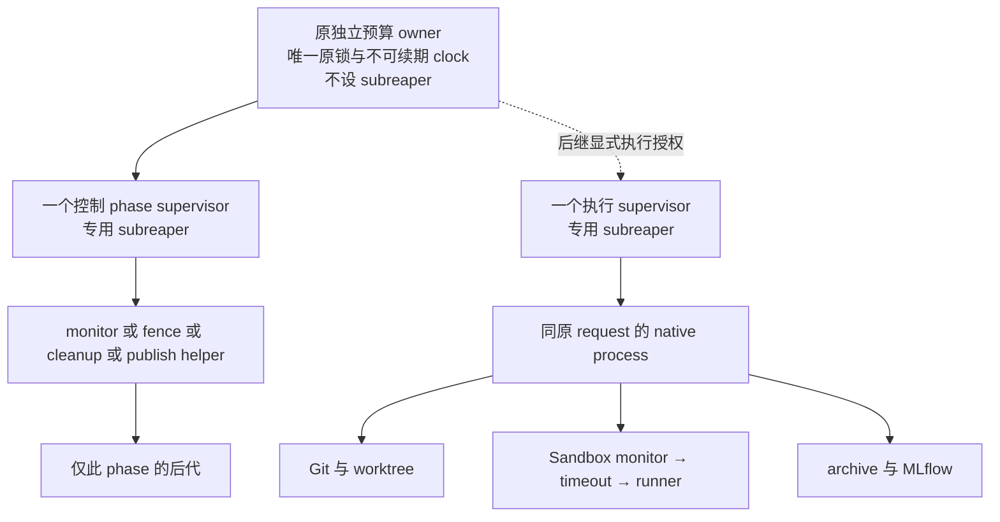

# B3.3：原训练 executor 生命周期接缝调研

日期：2026-11-15。本文是源码调研与设计建议，不是实现、验收或独立批准结论。任务范围只允许写本文及 ignored `.ergora/checks/training-executor-lifecycle-design/`；没有修改产品、测试或计划，没有安装、提交、推送、启动模型或服务。

建议先交付 **B3.3a：现有预算 phase 的监督进程隔离**，保持训练执行权关闭。实际执行还有一个不能用外层包装消除的前置条件：冻结的 `training_executor.process(folder)` 没有原锁内准入接缝，也没有 whole-executor 的不可重用 attempt。保持283参考字节不变、继续允许旧手工 executor 参与同一 job，同时要求原子核验和不接管旧不确定执行，这几个条件不能由现有接口同时满足。需要先决定最小原生协议升级或收窄实际支持范围，再审执行设计。

## 依据与观察身份

已读根／源码 `AGENTS.md`、[组件协议](../architecture/component-change-protocols.md)、[全周期计划](../plans/2026-11-15-training-budget-executor.md)、[原提交计划](../plans/2026-11-15-training-budget-submission.md)与B3.2交付记录。按 maintainable-project-delivery 和 ergora-codebase-quality 的实际 owner／调用链原则分析；这些材料中的既有运行和审查结果属于各自候选，本文没有重验。

开始读取时 HEAD 为 `b78f7b233316f3248c5a5865d90e6a23870693ac`，B3.2 r4在共享工作树；来源清单保存时 B3.2已固定为 `75d1ee325288527f67fb1ea814332d1522ff4860`，分支 `refactor/architecture-foundations`。本文以清单中的逐文件 SHA 为源码观察身份，不用 HEAD 代替在途文件身份。31项来源及283份 Git 跟踪参考文件的字节／SHA清单保存在 ignored `source-inventory.json`；忽略的运行期字节码不计入283。B3.2的648产品／283参考安装证据仍归原交付，本文不增加安装成功主张。

## 已核的真实调用链

|实际 owner／入口|源码事实|对B3.3的约束|
|---|---|---|
|[training.start／resume_start](../../src/ergora/training.py)，`_submission`|短控制库事务冻结原意图；RPC阶段不持控制库写事务。旧登记恢复只沿原提交／取消／fence。|新执行动作需独立的显式入口；不能让 start、普通 resume、GET 或旧登记恢复获得 runner 权限。|
|[原提交](../../src/ergora/reference_training_submission.py)，`dispatch`／`reconcile`|原 `.attempt.json` 在RPC之前保存；原 `.result.json` 绑定完整 intent SHA、spec SHA和run ID。失联只 lookup 同原输入并核 intent memo；已有attempt不重发。|这是唯一 start slot。不能把这个slot当作“executor已调用一次”的证据，也不能为执行重发start。|
|[BudgetedStart](../../src/ergora/reference_training_budget.py)，`own`／`supervise`|独立 owner持原锁、身份、context SHA和clock；当前自己串行调用 `processes.run(supervised=True)` 运行 monitor／fence／cleanup／publish。`executor_stop_confirmed` 固定为未知。|B3.2没有训练执行。为将来并行执行与控制做隔离时，四种phase都要移出父owner，不能只包装executor。|
|[预算 worker](../../src/ergora/reference_training_worker.py)，`create_adapter`／`_serve`|预算queue为 `ergora-training-budget-v1`；adapter沿原算法创建request，在registry锁内最后一次lookup检查预算。worker注册原控制activities。|消费预算queue、存在queued request、owner活着都不构成执行授权。升级不能使现有queue突然启动训练。|
|[原 LocalTrainingAdapter](../../src/ergora/data/reference/platform/local/agent_platform/training.py)，`create_job_if_absent`|native request恰为 `schema_version/job_id/experiment/runner`，job ID为 `local-perf-EXPERIMENT`；create／fence共用 `training/registry.lock`。|执行核验须覆盖完整request、完整Experiment和完整runner，沿原native文件，不另存一份实验状态。|
|同原owner，`run-local`|确认manifest SHA，等待原request存在，然后直接调用 `training_executor.process(request.parent)`；不持registry锁。|registry锁不能串行化手工executor。预算adapter的create gate不能代替最后一次executor准入。|
|[原训练 executor](../../src/ergora/data/reference/platform/local/agent_platform/training_executor.py)，`process`|第52–55行自己开 `executor.lock` 并取 `LOCK_EX\|LOCK_NB`；已有result立即返回；随后读request、校manifest、写started，再执行Git、runner、archive、track和原result／negative-result。|整个原过程都须处于专用进程子树内。不能只监督runner，也不能把已有native result当成后代收尾证明。|
|[Sandbox](../../src/ergora/data/reference/platform/local/agent_platform/sandbox.py)／[process_job](../../src/ergora/data/reference/platform/local/agent_platform/process_job.py)|Sandbox启动monitor时 `start_new_session=True`；monitor启动timeout／runner时再开新session。原process registry有request、started、boot／PID／start ticks、terminal和单独锁；started无terminal拒绝runner自动重执行。|只杀外层executor进程组会漏新session。原runner防重复不能覆盖Git、archive和MLflow，也不能用重启monitor来证明whole-executor可重跑。|
|[processes.run](../../src/ergora/processes.py)|监督路径把**当前进程**设为Linux subreaper；`timeout`不控制监督路径，实际停止依赖predicate。返回前kill直接业务子进程，再 `_reap_children` 循环kill／wait当前进程所有直接子进程及收养后代。|必须独占监督进程。一个phase退出可能杀掉同一owner的另一个phase；线程／asyncio不会改变这一Linux归属。|
|[reference_job_lifecycle](../../src/ergora/reference_job_lifecycle.py)，`BudgetedJob.own`|已有独立owner、attempt、pending、run返回后stopped、collection与unknown不重执行的模型。|可复用证据顺序和原回收算法，不能复制其task ledger／model slots，也不能原样复制同步写stopped／final的调用：训练发布仍须受监督。|

原 `core.git` 调 `/usr/bin/git`、每次timeout为120秒；原archive的Sandbox timeout为600秒；`track`含多个MLflow网络／artifact操作而没有此处的总deadline。这些单次限时不能替代原不可续期总clock。原 `ExperimentWorkflow` 的排队＋运行窗口和控制activity重试也不调用executor；它们不是另一个实际执行owner。

## 为什么先隔离所有 phase

现有 `supervise` 的唯一调用者是同模块 `own`；真正的子进程入口在 `reference_training_worker.budget_main`。这两个文件已经共同拥有阶段启动、原缓存核验和helper执行义务。最小改动应留在这两个owner，原 `processes` 算法保持；没有新建跨领域监督框架或每个动作一个模块的实际消费者依据。

|方案|取舍|
|---|---|
|父owner并发两次 `run(supervised=True)`|不可用。任一次 `_reap_children` 都会清理父owner的另一直接子进程，不论其业务属于哪个phase。|
|只把executor放子supervisor，控制仍由父owner直接supervise|不可用。父owner在控制phase结束时仍会kill执行supervisor；subreaper设置也不会随一次run返回自动清除。|
|一个专用supervisor串行执行executor再fence|复用简单，但executor／回收等待会推迟fence，反过来先等fence／fsync也会推迟实际停止，不满足执行与控制各自截止。|
|父owner普通进程；每个phase一个专用supervisor|推荐。每个supervisor只收养其helper子树；未来执行和控制可并行，各自用同原clock停止。a片只迁移现有串行phase，不增加执行。|
|cgroup／宿主级资源owner|可提供不同的强杀范围，但当前没有已授予的资源接口或验收；不能作为本片隐含依赖。|

建议的归属如下。执行分支仅表示后继设计，不表示a片启用它。



父owner只管理自己启动的直接子进程、原clock和捕获的boot／PID／start ticks；完整来源、控制库、归档、文件哈希、flock、fsync仍放受监督helper。supervisor不得继承父owner／submission锁，不能因父owner死亡后继承的fd仍持锁而冒充原owner。已有活B3.2进程不会因磁盘代码升级改变进程能力，不得重启或接管它。

新的phase包装应返回绑定唯一phase ID、mode、原intent／授权SHA、context canonical SHA的完整结果，且只在原 `run` 完成回收后返回。缺响应、异常退出或被SIGKILL均为unknown，普通exit code或helper业务结果不替代这一结果。父owner启动supervisor的stdin／stdout传输也不能成为新的阻塞点：原intent上界16MiB，不能直接在父owner同步 `.stdin.write(完整context)` 或读完整输出文件并假定瞬时完成。应在同一owner内做有界、可轮询的完整传输，或采用已有等价无阻塞传输接缝；不缩窄既有有效输入容量。这个义务需要a片自己的真实慢reader回归。

## 共同截止、并行停止与安全回收

在后继实际执行模式，执行supervisor必须独立持已核的原clock。它自己的stop predicate检查compute剩余、catchable取消、原owner身份失联及精确fence；不能等待控制helper完成fence、flush、控制面取消或结果发布后才停止executor。完整来源漂移由并行的受监督monitor核验；发现不可继续时父owner同时停止执行，并进入原精确fence清理。

compute截止应同时发起两个动作：执行分支停止并回收实际子树；控制分支停止monitor并沿原registry锁持久化精确fence，再在原剩余cleanup内做原run／取消对账。两条分支没有“先等fence目录fsync成功才kill业务”或“先等executor返回才开始fence”的依赖。registry锁、目录flush或MLflow阻塞只影响相应观察，不能拖住另一分支的实际回收。

有三个需要明确的停止边界：

1. `processes.run(supervised=True)` 触发predicate后才开始kill／wait／reap。`_reap_children` 里的 `waitpid` 没有有限耗时证明；Linux调度和不可中断I/O也没有硬实时上界。父owner在同一total deadline强杀supervisor，可能恰好杀掉正在回收的subreaper，留下helper或新session后代。**kill(supervisor)不等于reap子树。**
2. 与原B3.2一致的最小隔离方式，是helper仍用原compute／cleanup predicate停止，父owner等待已开始的原安全回收完成，不新增父级硬kill来打断reaper。total到期后不启动新的业务、helper、phase或成功发布；若仍在回收，只允许同树安全收尾并显示overrun／unknown。是否把这一事实写为后继明确合同，应由计划审查固定；本文不自行扩大预算合同。
3. 在原cleanup内提前停止helper、给reap／返回留余量可以降低正常调度风险，但固定余量不能证明总截止必然全树消失；它还会缩短有效操作窗口。若采用，应按可观察合同变化审查，不能称为纯机械整理或通过改测试预算掩盖竞态。若要求“父owner总截止必须退出，同时任意阻塞下后代已证实全部停止”，当前接口不足以给出这一强保证。

phase supervisor在自身启动／结果文件I/O中也可能阻塞；`processes.run` 在实际Popen前有输出目录和stdin文件准备。a片不能把“传了timeout／多了一层Popen”写成所有I/O都有硬期限。正常超时、catchable取消和受控阻塞应有实际进程证据；无法确认的情况仍保留原件和unknown。

原native result可能在执行supervisor完成 `_reap_children` **之前**出现。B3.2 `completion()` 只核native result和gate，后继受管执行不能原样用它宣布完成或让owner提前退出。对当前managed attempt，须同时具有匹配native观察和执行子树停止证据；若compute已到而仍未确认收尾，不能因看到SUCCEEDED就跳过阻断。没有受管attempt、先前已完成且等人工release的轮，继续保留其原结果与原人工入口，不统一fence。

## 原 executor.lock 内没有最后一次准入接缝

源码的关键顺序是：

```text
process(folder)
  打开 executor.lock，LOCK_EX | LOCK_NB
  已有 result -> 返回原 result
  读取 request
  检查 fence / manifest
  写 started
  Git -> runner -> archive -> track -> result
```

原函数没有callback、可传入的已持锁fd或“已取锁后执行”的公开函数，也不在无result时拒绝已有started。外层另开fd先持同锁再调用原函数，会使内部非阻塞flock立即失败；不是可复用的同一锁。改拿另一个application锁只能串行化新入口，原手工run-local不会遵守它。

仅锁外预检有以下可达窗口：

|顺序|新受管调用|原手工调用|
|---|---|---|
|1|检查request匹配、没有started／result；保存自己的process attempt|尚未开始|
|2|尚未进入原process的executor锁|先拿原锁，写started，开始Git或runner|
|3|仍在调用原process之前|崩溃，原锁释放，留下started而无result|
|4|原process取锁成功；它不拒绝started，继续执行|旧不确定执行未被安全对账|

这时新attempt即使不可重用，也不能证明它没有接管旧不确定executor。若旧调用仍持锁，新调用会失败；这只覆盖窗口中的一种结果。原process_job的started防重保护runner，不解决Git、archive、tracking或whole-executor归属。

保持283原字节的当前阶段，只能明确承认：在同job存在历史／并发unmanaged executor时，没有足够接缝给出上述原子准入保证。把“操作者保证永不运行原手工命令／没有旧执行”的运维假设作为支持前提，属于较弱合同；控制面自己不能证明它。单独持registry锁、换进程组、复制process、AST重写、Path／open代理或广泛monkeypatch都不能作为这个缺口的透明修复。

若后继授权升级原生协议，最小接缝应仍由 **原training_executor owner** 提供：在它已经持有的executor锁内、任何started／Git／runner动作之前，核实际request，拒绝不确定旧started，并调用窄的受管admission hook（或提供等价的原锁内调用接口）。受管hook在这一临界区完成精确request／原owner／截止核验和不可重用process attempt／ack的持久发布；失败不进入业务。原Git、runner、archive、track、评分和result算法不复制。已有result只作为原观察返回，不能追认受管停止证明。

这是持久恢复语义的协议升级：旧started无result此前可以再次进入process，升级后需明确拒绝／对账规则；还要决定无hook手工调用如何识别已有managed attempt，以及旧安装／旧writer的支持边界。它会改变参考身份、镜像／manifest和安装校验，**不属于当前283零改约束下已可实施的方案**。应另片授权、固定版本并审查，不能在应用wrapper里暗加一套native算法。

## 后继执行授权的最小合同建议

这些是待审建议，不是当前接口。一个显式执行动作只针对**原已submitted run且已存在的同完整native request**；不顺带start、不从当前配置重建request、不为unknown找另一个run。CLI名称可随后按现有命令惯例固定。

准入顺序建议为：

1. 用当前home的原start intent、原start attempt／receipt与原预算来源，核同项目／revision、登记发布来源、ready、compute剩余和活owner；旧登记恢复模式不允许该动作。原receipt缺失时先沿原 `reconcile` 核memo及完整run，不能凭request存在授执行。
2. 沿原 `lookup(client, spec, run_id=固定run_id)` 读取同run完整历史初始Experiment，核原intent memo及允许执行的控制状态；若控制面不可确认或已取消／终结，拒绝新工作。网络／历史读取放受监督helper，全部耗原期限，不增加新的start客户端。
3. 读取native request原字节并核完整形状：`schema_version == 1`、精确job ID、完整原Experiment、完整原runner（包括repo、argv、timeout、template ID、project）。`_Submission.native_request()` 目前只核job ID，不足以独自授权执行；`completion()` 已有完整Experiment／runner比较可以复用其意图，但不是原子执行gate。manifest仍核原字节SHA，原baseline／比较器／归档合同不改。
4. 只有新出生且明确支持执行协议的原预算owner，才接受这个不可变执行请求。旧B3.2 `owner.json` 是schema 1且严格校验精确字段，没有执行能力。推荐后继用明确版本的owner能力合同；新reader兼容读旧身份，旧身份只能维持原控制能力。不能给一个仍活着的旧owner补能力文件、改owner.json、重启owner或把代码安装成功当作能力升级。
5. 原start intent及其budget引用不重写，原memo／slot不变。执行请求绑定原intent SHA、authorization SHA、固定run ID、job ID、原native request bytes SHA、执行协议和明确确认。沿同native job保存，不新增索引库或训练表。持久请求只表示请求已保存；只有原锁内admission成功才可能调用process。
6. 在原executor锁内再核同原request、无旧不确定执行、精确fence、活owner与compute剩余，保存单次process attempt及ack后进入原process。这个步骤依赖上一节尚不存在的原生接缝；不能在实现时退化为锁外预检。

普通 `cycle-start`、旧预算queue、worker重启、status／stop-status、resume-start、原登记恢复都不默认产生该执行请求。现有B3.2 owner能力不足时应明确拒绝执行，同时保留其正常fence／对账。将来自动循环只能调用同一显式应用用例，不能成为第二权限来源。kernel专家继续保留在v3提案路径，其意见不提升为执行或批准。

## 原 process attempt、ack、stopped 与结果的区别

建议同native job下保存少量不可变生命周期记录；目录名和schema尚待执行计划固定。它们不记录第二份训练状态，不取代native request、result、gate、archive或MLflow。

|记录|需要绑定的身份／顺序|恢复语义|
|---|---|---|
|原start `.attempt.json`|已有原intent／workflow／spec SHA，在start RPC前保存|唯一训练start slot，始终保留；执行不删除、不归还、不新发。|
|显式执行请求|原intent／授权SHA、run ID、job ID、request原字节SHA、协议、确认|同一原件重读；缺能力／缺来源不启动。没有它，新owner也不能自动执行queued request。|
|process attempt|执行请求SHA、同原job／run／request身份和一次attempt ID；原锁内、业务前发布并完成目录同步|持久化不完整、发出后失联或无ack均保留unknown；不能因为“可能还没调用process”删除或重用。|
|ack|同attempt及supervisor／实际executor boot、PID、start ticks；在任何业务动作前完成发布|只证明受管进程接收了原执行，不证明成功或停止。ack发布阻塞仍在执行supervisor所辖子树内，可被原clock停止。|
|stopped|同attempt／request／run／supervisor身份，原supervised run的结果、实际reap完成与观测时刻|只能在原run完成回收之后产生；成功发布后才可确认这个受管子树停止。缺失不从锁释放、native result、PID不存在或控制终态补造。|
|原native result／gate／archive／MLflow|原executor原样产生|原训练事实；既不代替stopped，也不由预算owner合成CANCELLED或SUCCEEDED。|
|预算final|分别引用fence持久观察、控制面事实、native结果、受管attempt停止观察、未确认原因和实际overrun|publish同样受监督；耗尽时允许无final，同原fence恢复规则保持。|

新元数据沿既有普通文件／no-link／strict finite duplicate-key JSON及1MiB记录界，完整intent沿原16MiB，cycle沿原10MB，不借新包装缩窄有效输入。canonical SHA只核结构身份，request bytes SHA核原文件字节，两者不混用。生命周期记录只引用原权威与原clock，不复制可续期授权。

停止证据的发布也不能阻塞实际停止：执行supervisor先完成业务run及reap，再在其自己的单一子树中用剩余cleanup监督stopped发布；与控制分支的fence／fsync互不等待。发布耗尽时可以“实际已回收但缺持久证明”，对恢复仍是unknown。若采用其他发布位置，也必须保留这个顺序和独立性，不能让父owner直接fsync。

owner或supervisor被SIGKILL、跨boot、缺proc、PID身份不符、原请求／attempt／ack缺损均不自动重启执行。存活的supervisor可以按原clock停止它已有的子树，但观察者不能因此先行声称停止已证实；旧owner／锁已消失也不授新进程权限。

## 解释器与依赖仍是实际执行接缝

当前应用core依赖PyYAML／jsonschema，`ergora[temporal]` 只增加Temporal SDK；它不声明MLflow。原 `training_executor.track` 在调用时import `mlflow.MlflowClient`，原native `requirements.lock` 才锁定MLflow；原 `core.PYTHON` 还固定了runner／archive所用native `.venv/bin/python`。因此，不能把预算worker的应用Python直接当作已具备完整executor环境。

推荐沿选定原安装的native解释器运行整个原executor，应用supervisor持原clock；必要的原锁内admission入口应能在该解释器按明确依赖运行。完整预算source／DB核验仍由应用helper完成，native最后gate只复核必要原身份、request、attempt、clock和fence，不能偷偷import缺jsonschema的reader。另一可审选项是给应用环境明确声明并验证执行所需依赖，但这改变安装合同，应单独固定。不能拼接另一个环境的site-packages，也不能把依赖可import冒称MLflow服务可用或完整训练成功。

## 建议的最小分片与验收接缝

|建议子片|完整可审交付|最小验收接缝|
|---|---|---|
|B3.3a phase隔离|原owner不启subreaper；四种既有phase各有专用supervisor；原调用仍串行、无新增runner权限，原clock／slot／queue／283保持|沿原 `test_training_submission`／预算fixture保留accepted／held、lost-ack、completed、monitor阻塞、registry锁、fence与final文件／目录fsync、同原fence恢复；增真实两supervisor互不回收、setsid后代回收、慢完整输入、supervisor强杀unknown与catchable取消时reap不被打断。|
|执行协议设计与来源能力|固定显式请求、owner能力版本、旧reader／旧owner／旧恢复边界、request完整验证、process attempt与stop证据；同时决定是否升级原生锁内接缝|新的fresh-context计划审查直接看原锁内缺口和状态顺序；不以“未来再补原子gate”批准可运行执行。若283零改约束保持，则该执行能力保持不支持。|
|原生接缝及单job完整CPU生命周期|仅在协议升级已授权后实施；同原submitted run／request，原process算法，执行与控制各一分支，原截止下实际回收并保存独立观察|原 `test_training_submission` 继续持run／memo／原slot；沿原native executor／processes接缝实际触发Git准备、runner、archive和tracking阻塞／取消，持fence锁／fsync时实际业务及setsid后代已结束；真实原executor锁竞争和旧started无result不得被接管；SIGKILL／丢ack不重启。|
|每片自己的安装与交付|最终非editable身份、相关原件、实际CLI／控制流程、自身原审查模板、新fresh-context产品两轴、普通发布及自己的CI|源码、安装、SDK服务替身、真实Temporal和真实训练范围分开；先前648／283和B3.2控制流程不转授为后继执行通过。|

几个回归尤其不能用浅断言替代：

- **控制阻塞与执行停止同时存在。** 真正持registry锁或让fence目录fsync进入故障marker，另一个分支运行实际CPU／新session后代；核实际PID身份已经消失或被原reaper收完，然后才释放故障。仅看到predicate／final字段不能证明这个解耦。
- **锁内准入竞态。** 在最后外层预检与原锁获得之间，让原手工executor写started后异常退出；新入口必须拒绝业务。外层持另一个锁或只模拟“旧锁仍占用”不能覆盖此窗口。
- **native result先出现。** 原result已写而执行supervisor仍有真实后代未回收时，不能宣布stop confirmed或让owner完成。现有task `test_budget_jobs` 的pending／detached-descendant场景提供相邻的证据顺序范例，不能把task账本搬过来。
- **Git和tracking确实处于监督范围。** 原Git用绝对 `/usr/bin/git`，仅替换PATH中的git不构成该接缝验收。可用受控原生子进程暂停／故障注入；MLflow网络可用本地可替代依赖，但应执行原track调用顺序并标注服务替身范围，不能把替换整个track函数说成完整MLflow验收。
- **新权限保持关闭。** 更新后只start预算queue、原旧owner仍活着、旧恢复被调用，都不得产生executor／process attempt。新显式请求重复调用、owner／supervisor强杀后的恢复必须保持同原件且不再执行。

每个大项先固定完整计划再独立审查，产品片各自验证与审查后才闭合；本文只提供素材，不替代fresh reviewer。新行为不在a片“行为保持”名下夹带，Kernel专家不删减或绕过。

## 待决与本次检查边界

仍需后继计划明确：原生锁内接口及旧writer升级是否获授权；是否接受只有运维假设的独占执行范围；owner能力schema及旧版本reader策略；执行命令与不可变记录精确形状；原native Python下最后gate的最小依赖；总截止后仅安全reap及overrun的公开合同；native result已存在但无受管停止证据时的只读呈现。

本次只做源码／文档读取、Git身份读取、来源字节清单与本文静态完整性检查。没有运行产品测试、实际executor、训练、MLflow、Temporal、模型或GPU，没有用短CPU替身认证训练质量或性能收益。原283参考保持的检查只覆盖本次读取清单的逐字对照，既有安装结果仍归原候选。具体检查结果保存于同ignored调研目录；本次没有给出独立approve结论。
