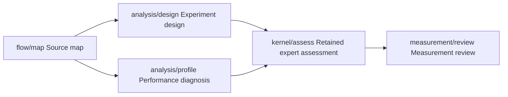

# Turn expert proposals into experiment contracts

English · [Documentation](../README.md)

## Map expert proposals into the original experiment contract

First complete [expert proposals and manual handoffs](#optional-experiment-expert-proposals) below, saving complete manifest, selected leaf input, original result and actual backend records. Original result free text is for human review, not directly usable as `experiment.json`. These steps apply to every optimization direction. Actual files still use original templates from `ergora templates copy training-optimization`; execution commands follow the [complete reference guide (Chinese source)](../../src/ergora/data/reference/platform/docs/TRAINING.md).

1. Identify real project, optimization goal and semantic changes allowed, then separately select baseline owner, candidate author, trusted runner, independent evaluator and adoption owner. Pass common design/profile originals to global kernel; direction specialist/design originals to their measurement, with low-precision first passing its own kernel predecessor. Final measurement receives all relevant original results and actual experiment materials.
2. Fill the contract using the table below. Record real sources and human decisions for every value. Fill missing actual commit, configuration, data, initial state or acceptance method first, retaining unchecked status. Example proposal numbers, estimated search costs and self-generated PASS do not become real measurements.
3. Set `contract_approved: true` only after human review of scope, checks, quality and resource budgets. Register real baseline/runner, then run `prepare`. It checks canonical commits and aliases, repository commits, current baseline and comparator, adds original runner/window fields and freezes original bytes. Then verify actual published manifest using `experiment.binding.manifest_sha` from `training show`; do not substitute SHA of proposals, drafts or reformatted JSON.
4. Original runner executes the exact manifest, generating trusted evidence, independent checks/review/quality and paired comparison. Measurement may interpret these originals and identify gaps; its `approve` replaces neither experiment gates nor human adoption. Finally approve by original `evidence SHA`, then hand off to that project's development integration/revalidation task.

|Target file/field|Source and decision|
|---|---|
|Goals, hardware, data, updates, measurement, stop/recovery and resource authorization in `workload-contract.md`|Real project description and original configuration/reports. Profile identifies gaps; design gives bounded suggestions; the operator confirms valid source samples, rank scope and actual optimizer-update semantics. Markdown does not automatically become a workload fingerprint.|
|`baseline_id / commit / config_sha256 / workload_fingerprint / evidence_uri / quality_scope` in `baseline.json`|Exact commit, final effective configuration, workload identity, original evidence location and quality scope confirmed by the baseline owner. `baseline_ok` checks the first four against the experiment; evidence URI and quality text still require human verification.|
|`schema_version / experiment_id / baseline_id` in `experiment.json`|Register under original schema 1 with unique experiment identity and the same baseline. Reconcile uncertain results by original ID first. Changing bound content requires traceable revision through the original process.|
|`execution` and configuration/reference fields|Specify the required operation through [operation selection](prepare-experiments.md#choose-full-or-lightweight-screen), verifying selected-source capability and complete input/reference identities. Screening proposals replace neither full verification nor adoption.|
|`track / allowed_changes`|Choose E/N/A from actual changes and state exact boundaries. Direction names such as kernel, packing or low precision cannot automatically determine classification. Proposal advice grants no permission to modify oracles, thresholds or trusted runners.|
|`owner / author / contract_approved`|Actual owner/candidate author and human contract decision, not model backend names. Independent review `reviewer_id` must differ from author; the trusted process is responsible for authentic identity.|
|`baseline_commit / candidate_commit`|Complete Git commits in the real runner repository. `prepare` adds identical `baseline_sha / candidate_sha`; conflicting aliases are rejected. Design formulas, generated snippets and original-result digests are not candidate commits.|
|`workload_fingerprint / environment_fingerprint`|Project-fixed workload and real environment identities, including actual effective batch/token, precision, software/hardware/mesh conditions. Retain original fingerprint inputs. The project defines content and normalization rules; the platform neither automatically discovers nor proves their authenticity.|
|`dataset_manifest_sha256 / initial_checkpoint_sha256`|Real data-manifest and initial-state artifact digests, retaining reproducible provenance/content scope. Do not use examples, filename SHAs or checkpoints not actually consumed.|
|`base_config_sha256 / candidate_config_sha256`|Freeze both arms' inputs by runner-defined material role. Trusted configuration drivers use original byte SHAs of Git configuration sources or prepared-json materials (including BOM/original newlines), never observation snapshot SHAs. Actual construction, complete snapshots and semantic identity are separately saved in this receipt. Ordinary full runs substantiate actual configuration through project contracts. Parseable configurations or proposal parameters do not prove runtime use.|
|`validation_contract_sha256 / checks_required`|Project independent oracle, tolerances and required shape/stride/gradient/RNG/all-rank/recovery coverage with a frozen contract. Check lists must be nonempty and unique. Template JVP and similar items are examples only; select sufficient checks for the real task, never removing required items to accommodate PASS.|
|`quality_required`|Explicit boolean; N/A requires true. The project contract also decides whether E needs task-quality evidence. Short loss, single-operator error or one forward pass does not automatically replace training/service quality.|
|`comparison_tool_sha256 / performance_policy`|Verify actual pinned `compare_runs.py` original byte SHA; approve actual normalized units, paired repetitions/statistics/thresholds. Original gate recomputes and checks both arms' code, configuration, environment, data and initial state. Local kernel speedup or Amdahl estimates cannot substitute for overall paired measurement.|
|Runner `schema_version / runner_template_id / project / repo / command / timeout_seconds / configuration_readback`|Current runner schema2 has exactly seven fields; use real project Git root and trusted argv. Null readback supplies ordinary full with `{manifest} / {output} / {baseline_repo} / {candidate_repo}`. A driver object uses fixed three argv, manifest-selected source-bytes inputs and original managed execution; prepared-json requires `prepared_json_format=json-v1`. Use verified environment/resource permissions and preserve unique job/rank/cancellation ownership.|
|`prepare --max-run-seconds` and added fields|This queue-plus-execution window must at least cover runner execution walltime; check both budgets separately. Prepare also adds `runner_template_id / max_run_seconds / local_project`. Reconcile total search, model-call and native-retry costs with original owners separately. One walltime cannot establish control of the entire budget.|
|`notes` and human traceability table|Record proposal manifest/input/result identities, locations describing complete predecessor-result digests, decisions and gaps. If notes record a traceability-table SHA, humans may check table and originals. Existing validators do not automatically verify this association; the table is no new execution/approval credential.|

Save an ordinary Markdown traceability table in the project's persistent materials directory. Its format belongs to the project; no new database or conversion service is needed. Record these relations, adding actual manifest location/SHA when available:

```text
Original composition root id / version / digest; complete manifest digest
Selected instance path; input digest; original run ID / actual backend / model / fallback reason
Location / SHA of each complete original result, and original predecessors received by kernel and measurement
Original contract field → actual source / SHA → human decision / owner → unchecked items
Original preparation intent / actual published manifest SHA → original runner / job → evidence SHA / original approval
```

These identities serve distinct purposes: composition manifests freeze templates/materials; leaf inputs freeze this task; results freeze original model output; experiment manifests bind real candidates/contracts; evidence SHA binds execution evidence. They are not interchangeable and acquire no automatic execution authority by appearing in one table.

Failures, `no_gain`, noise, gaps and `unknown` retain original identities and budgets. Only trusted execution, independent correctness/quality and statistics satisfying the contract enter the original adoption flow. Native-tool completion, generator self-reported PASS or favorable measurement advice does not close this step. See the [original evidence format (Chinese source)](../../src/ergora/data/reference/platform/upstream/docs/evidence-format.md) for fields.


The inherited [native-harness preflight policy](../../src/ergora/data/presets/workflows/ergora-training-proposal/skills/ergora-library-environment-optimization/SKILL.md#native-harness-preflight-and-failure-reporting) records process-set host accounting, owned short IPC/temp paths, explicit optional-stream sentinels and primary-failure preservation. Applicable Tensor FD/socket changes require real regressions through the target's existing harness/DataLoader construction with matched runtime and multiprocessing settings; pathname-only or mismatched CPU controls retain their limited scope. Record actual availability, original failures and cleanup in the existing environment-change record.

## Hand experiment candidates to development tasks

After training evidence is approved by original evidence SHA, create an integration/revalidation task using repository-governance or large-change in the same business project. First register the corresponding development template, paths and trusted checks with `project register`. Follow the [formal task journey](../development/templates.md) to preview, create, submit and approve the exact plan, then verify verification/review and candidate against original run results and export a local branch. Training approval, development-plan approval and business merge retain separate original evidence and cannot replace one another.

After the development integration/revalidation task closes, follow [handoff packages](../development/evidence-and-export.md#collect-and-verify-handoff-packets-offline) to collect its frozen index and receipt-specified materials for offline byte checks without services. This package does not automatically collect independent training experiment data, checkpoints or complete statistical sources. Preserve training evidence, original approval SHA and reproducible experiments through this guide.

`ergora task cancel/reconcile` handles only uniformly created/submitted development tasks. Training experiments, Forge campaigns and remote jobs still use their own native IDs, cancellation and recovery protocols. A development task's external confirmation does not prove GPU/remote experiments stopped. If formal development and training share execution state, inspect all in-flight jobs before stopping workers/execution stacks. Closing the console alone does not mean external jobs were canceled.

## Memory, Skills and sources

- Save verified project conventions as memory with provenance and revisions. `ergora agent run --recall QUERY` passes selected project memories as checkable observations.
- Save operational knowledge in standard Skill directories. After manually or GEPA-generated candidates, evaluate fixed train / validation / holdout splits, checking correctness, reported costs and generalization limits before explicit adoption. This optimizes text assets, without updating model weights.
- Configure bounded URL observations for explicit official documentation/paper sources. Changes generate proposals awaiting review. Temporal Schedule can trigger durably, is paused by default and has a separate budget per invocation.

For JSON inputs/outputs and adoption, use [Skill evaluation](../improvement/skills-and-evaluation.md), [memory/ReMe](../improvement/memory.md) and [research scheduling](../improvement/research-and-schedules.md). Base [installation](../install/linux.md), [console operation](../operations/console.md) and [backup](../operations/backup-recovery.md) have separate owners.

## Integrating specialized Agents

Templates declare experiment-planner, performance-analyst and kernel-tuner capabilities/artifacts in `agent-contract.json`; project-role bindings select actual Agents. Project runners can connect parameter searches to existing tools such as Optuna. Trusted experiment execution and numerical/quality/performance revalidation stay outside the generator.

[OpenBMB/ForgeKernel](https://github.com/OpenBMB/ForgeKernel) offers optional pinned-version native campaign adaptation. Install a separate tool environment and configure local tasks/devices first, then use `ergora kernel plan/prepare/status/run` or the training page. The pinned version supports only Claude backend; plan checks and campaign creation call no model/GPU. See the [Agent guide](../agents/forgekernel.md#forgekernel-native-candidates) for complete configuration, continuation and uncertain-result reconciliation.

Generator-native reports are candidate materials only. Submit candidate code, freeze the experiment manifest and run the [trusted evidence gates](evidence-and-approval.md). See the [backend guide](../agents/backends.md) for KDA, ForgeKernel and mini-swe-agent comparisons/licenses. CPU interface validation cannot prove GPU performance improvement.

## Optional experiment-expert proposals

`ergora composition install-preset training-optimization` imports current common root `ergora-training-proposal@4.2.12`: source mapping, cross-domain experiment design, pure performance diagnosis, kernel implementation-plan assessment and independent measurement review. All five leaves inherit library/environment selection, the [delegated execution policy](../../src/ergora/data/presets/workflows/ergora-training-proposal/skills/ergora-bottleneck-optimization/SKILL.md#specialist-execution-and-supervision) for assigned execution specialists, and original evidence contracts. Model is fixed at gpt-6.2-sol, with max for design/kernel planning and high for diagnosis/measurement review. Selected-direction specialists enter complete optimization as actual structural descendants of this common root. They help operators fill original workload/baseline/experiment contracts; they neither execute search nor grant adoption. Real CPU/GPU execution remains with original runner/evidence gates.

|Leaf path|Main responsibility and required materials|Result boundary|
|---|---|---|
|`root/analysis/design`|Freeze workload/baseline, target units and quality gates; choose bounded actions by bottleneck; list combined interventions, budgets, stop and rollback|Experiment proposals for the original runner; no resource allocation or search execution|
|`root/analysis/profile`|Analyze supplied trace/memory/rank/topology and data paths, distinguishing collection conditions, critical paths and uncertainty|Existing-report analysis and falsifiable hypotheses; no invented new profiles|
|`root/kernel/assess`|Freeze shape/stride/precision/alias/RNG/derivatives and real wrappers, considering fusion/graph/memory/communication|Text/design is a candidate; uncompiled or independently unverified output is no usable kernel|
|`root/measurement/review`|Check exact candidate, independent correctness/quality, paired windows/ranks/variance and total cost; distinguish kernel/wrapper/step/service|Scoped review opinion; missing/failure/no_gain/noise/unknown never becomes gain or adoption approval|

First generate a grant and complete manifest for this exact root, then prepare a leaf input through [single-leaf invocation](../definitions/workflows/leaf-calls.md#call-a-prepared-leaf). With Skill attachments, select Linux/WSL2 `task-mcp` and ensure complete frozen resources are actually read. One `run-input` does not execute graph predecessors. Operators explicitly hand complete design/profile originals and digests to kernel, then all relevant inputs and actual experiment materials to measurement. Missing reports, hardware or experiment data remain unchecked; placeholder numbers never count as measurements. Record backend-override reasons by actual leaf path; measurement preferably differs from execution backend. If unavailable, explicitly record authorized same-backend fallback.

Common design and measurement retain their global responsibilities; nineteen method-expert roles cover sixteen optimization directions and three evidence-support roles. Profiling/performance-diagnosis reuse performance-analyst; kernel topics reuse kernel-designer. Direction knowledge and native execution capability integrate separately. Installing current proposals does not integrate complete internal Forge/KDA workflows or arbitrary external MCP. Real experiments retain original manifests, trusted runners, independent evaluation and exact evidence SHA approval.

## Source-anchored flow maps

```bash
ergora composition install-preset training-flow-map
ergora composition show ergora-training-flow-map 1.1.1 --material
```

This root provides independent read-only leaf `root/map`, with Agent `ergora-training-flow-analyst@1.1.1`. Generate grant/manifest for root `ergora-training-flow-map@1.1.1` through [complete manifest and single-leaf input](../definitions/workflows/leaf-calls.md#prepare-complete-single-leaf-input), supplying complete training entry points, callers, actual configuration, requirements and existing original reports. Complete `review read` results from an [exact local package](../review/materials.md) can also serve as task. The Skill is self-contained without external attachments and supports authenticated backends' `text-only` mode.

```bash
ergora composition prepare-from-manifest ./flow-map-manifest root/map \
  --task ./full-training-source.json --directory ./flow-map-input --max-prompt-bytes 1000000
ergora composition run-input my-project ./flow-map-input --backend codex \
  --mode text-only --timeout 600
```

The original run response retains three artifacts: source-anchored algorithm map, execution/communication/parallel-dependency map, and key-state lifecycle table. It also supplies necessary dependencies, falsifiable redundancy-removal hypotheses and minimal additional-evidence requests. It distinguishes read source, inference, configuration declarations and actual runtime; missing external modules/traces explicitly make maps incomplete. Identical code, mathematical zero terms or repeated storage require checking producers/consumers, gradients/collectives, versions and lifecycles before removal; appearance alone is insufficient.

Preserve original reference and workload/semantics first; the original runner then fixes comparable baseline and measurements. Maps themselves prove no bottleneck, implemented parallelism or gain. Explicitly hand this leaf's complete original result to design/diagnosis experts; it never automatically invokes later nodes. Kernel-expert assessment remains in the new overall path below and may conclude no kernel change is needed. Select actual decoupling/redundancy, memory, communication, host-scheduling or operator interventions by evidence. Original owners retain multi-round execution; this leaf replaces neither training nor adoption approval.

## Organize complete proposals around bottlenecks

```bash
ergora composition install-preset training-optimization
ergora composition show ergora-training-proposal 4.2.12 --material
```

Current common root `ergora-training-proposal@4.2.12` combines maps and four cross-domain experts. Root Skill owns evidence, direction and library/environment selection; child Skills retain their methods. For complete specialized optimization, revise this common root to place the complete root reference returned by selected-direction installation among its actual descendants before freezing a complete manifest. The [selected MoE composition example](../../examples/composition/optimization-selected-moe/README.md) supplies the current 18-leaf native development graph and complete handoffs; its [publication.json](../../examples/composition/optimization-selected-moe/publication.json) supplies formal root identity. Use actual returned full root references and manifests. The graph gives design the original task and gives profile that task with the checked FlowMap and its original producer.



For a [standalone read-only graph](../definitions/workflows/compose.md#run-a-standalone-workflow-graph), prepare the exact manifest and a `proposal-inputs.json` document with a single root `task`. Within that object, include the complete original request, source and baseline material. Put the exact baseline SHA-256 in `baseline.raw_sha256` and source SHA-256 in `source.source_sha256`. Replace the placeholders below with the project, grant and digest from the selected original manifest.

```bash
ergora composition prepare-manifest ergora-training-proposal 4.2.12 \
  --grant ./proposal-grant.json --directory ./proposal-manifest
ergora composition run-graph PROJECT ./proposal-manifest --manifest-digest MANIFEST_SHA256 \
  --inputs ./proposal-inputs.json --directory ./original-proposal-run \
  --max-prompt-bytes 500000 --timeout 600 --recoverable
```

FlowMap uses a required response field with null for unavailable evidence. A missing, mismatched, or over-limit FlowMap produces a block against `root/analysis/profile` before its reservation. The independent design leaf retains its original result. Use `composition inspect-graph` for the same manifest and original run directory. Its FlowMap diagnostic is corroborated when the original input and producer result are both available and match the receipt, and is receipt-reported when that evidence cannot be reconstructed. Kernel and measurement work use the source and evidence supplied in the original task. The single-leaf path still takes its explicit caller-supplied inputs.

The inherited policy retains one owner per direction and aims for 4–8 active experts with assigned work from the latest trusted profile. When an expert finishes or encounters a blocker, record the outcome and check which authorized independent work is ready. This stock graph has two independent analysis leaves after flow, and each explicit leaf call runs one member. Select independent topic assignments in an exact revision before freeze, use supported execution capabilities and report the actual active count and blocker.

The [profile-driven selection and handoff policy](../../src/ergora/data/presets/workflows/ergora-training-proposal/skills/ergora-bottleneck-optimization/SKILL.md#profile-driven-direction-selection-and-handoff) chooses each round's relevant subset from trusted profile/source-flow evidence. Complete the current direction's agreed work, measurements and cleanup before changing priority under the original bounds. Switching direction uses that direction's different owner; the previous expert retains its direction and results. Later selections need an exact revision before freeze, with the original measurement, quality, clock and stop owners intact.

|Leaf path|Complete materials required at invocation|
|---|---|
|`root/flow/map`|Original requirements/exact sources/callers/configuration and existing original reports|
|`root/analysis/design`, `root/analysis/profile`|Same original task/sources plus complete original flow result|
|`root/kernel/assess`|Original task/sources plus all complete original flow/design/profile results|
|`root/measurement/review`|Original task/sources plus all complete original results from those four leaves and actual candidate/experiment/independent-check originals; explicitly identify gaps|

Each root stage binds the original root task; dependency edges express order. `prepare-input/run-input` still only prepares/invokes the selected leaf, without executing predecessors or collecting port contents. Following the table, callers add original JSON result envelopes and input/result identities to task, retaining every response, failure and uncovered scope. Summaries cannot replace originals. Final all-join retains every stage, rather than only the final favorable opinion. Use existing [sharing and single-leaf entry points](../definitions/workflows/leaf-calls.md#prepare-complete-single-leaf-input) for grants/manifests. For example, start with a public small task in the checkout:

```bash
ergora composition prepare-from-manifest ./training-manifest root/flow/map \
  --task examples/training/host-redundancy.md --directory ./flow-input \
  --max-prompt-bytes 1000000
ergora composition run-input my-project ./flow-input \
  --mode text-only --backend codex --timeout 600
```

The [CPU redundancy-removal task](../../examples/training/host-redundancy.md) lets kernel experts explicitly conclude no operator changes are needed. The [conditional kernel-design task](../../examples/training/kernel-hypothesis.md) demonstrates candidate design under an explicit diagnostic hypothesis. Both are authored proposal exercises only, supplying no actual training/trace/quality/gain evidence; measurement review must retain these gaps. Invoke other leaves with paths above and a new task containing missing originals, rather than presenting initial-source-only input as complete handoff.

Direction selection never skips kernel assessment. Actual interventions may concern redundancy/dependencies, memory, parallelism, communication, scheduling or operators; root Skill lists applicable problems for existing direction presets. Explicitly install/freeze/invoke selected subtemplates and return complete results. This root does not dynamically run or attach every direction. Original contracts retain real experiments/cancellation/unknown recovery, paired comparison, independent quality and owner adoption. This recipe has not implemented automatic branching, continuous cycles or cross-round budgets.

Continue: [Prepare an exact training experiment](prepare-experiments.md) · [Select an optimization specialist](specialists.md).
