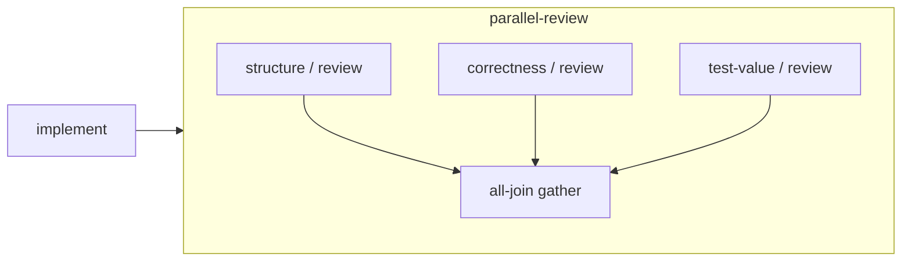

# Workflow composition examples

These packages demonstrate structural inheritance, serial execution, parallel execution, and explicit all-join. See the [workflow definition manual](../../docs/definitions/workflows/compose.md) for complete commands and data formats. A base installation can inspect / preview them without model keys or services. Formal development can [run parallel-review parallel branches or serial-review serial / parallel branches](../../docs/development/preparation.md#freeze-a-review-composition-for-a-formal-task); specialist-delivery below can assign two specialists to original work units and then hand off to the overall review. kernel-delivery has no explicit work join and remains a static definition example.

Dependency order:

1. Import the [kernel implementer](../agents/kernel-implementer/agent.json), [structure reviewer](../agents/architecture-reviewer/agent.json), [correctness reviewer](agents/correctness-reviewer/agent.json), and [test-value reviewer](agents/test-value-reviewer/agent.json).
2. Import [structure-review](structure-review/workflow.json), [correctness-review](correctness-review/workflow.json), and [test-value-review](test-value-review/workflow.json). Each can be previewed separately.
3. Import [parallel-review](parallel-review/workflow.json), which references the three child workflows and waits for all required branches.
4. When structure review must precede the others, import [serial-review](serial-review/workflow.json). It still references the three child templates, passing structure review outputs to two successors through named ports. Formal execution requires explicit `review_protocol: "dag-v1"`.
5. Import [kernel-delivery](kernel-delivery/workflow.json), which expresses passing kernel implementation results to the overall review.

Every leaf inherits all materials on its current structural path; reviewers do not inherit the predecessor kernel implementer's Skill. Examples request Codex and Claude Code; runtime admission checks actual installation, capabilities, authentication, and permissions. Backend overrides record reasons by member path. Importing a workflow does not execute commands in the package. Example specialist prompts are starting points without effectiveness evaluation; formal parallel review must pass original candidate and receipt checks for each member, and all-join provides no human approval.

When changing any package, increment its version, refresh local resource digests, package digest, and parent references, then publish a new root. The [example grant](preview-grant.json) previews all 10 structural instances and complete static prompts; a grant is preview input, not a project authorization record. Formal delivery still requires the original six stages and trusted checks.

[review-requirements](review-requirements/workflow.json) is an independent WorkflowDefinition v2 example: the structure expert is required and the test-value expert advisory; responsibilities belong to node instances. After importing the corresponding Agents, it can be inspected, previewed, frozen, and shared; [format and commands](../../docs/definitions/workflows/contracts.md#static-required-and-advisory-review-declarations) explain the boundaries. Formal tasks use v3 trusted advisory review or explicitly select dag-v1 to enter v4; advisory request-changes retains the original FAILED receipt, and execution failures still block. Existing v1 examples and old tasks retain their original identities.

Use `composition prepare-manifest` to save the entire composition tree and all resources at once, share the whole directory, then directly `verify-manifest`; recipients use `prepare-from-manifest` to prepare complete input for a selected leaf. See [saving and sharing complete compositions](../../docs/definitions/workflows/compose.md#save-and-share-a-complete-composition) for commands, permissions, and capacity limits.

[specialist-work](specialist-work/workflow.json) references [kernel-implementer](../agents/kernel-implementer/agent.json) for implementation and [validation-implementer](../agents/validation-implementer/agent.json) for validation, covering both with explicit all-join. [specialist-delivery](specialist-delivery/workflow.json) sequences this work child template with parallel-review for one-to-one assignment to original units; import the validation expert, specialist-work, then specialist-delivery. See [specialist implementer execution](../../docs/definitions/workflows/contracts.md#specialist-writers-and-original-work-units) for complete selection, original unit dependencies, explicit trusted-container selection, and backend overrides. Static preview grants no write permissions; formal v5 still requires original owner plan approval, trusted checks, and a commit. Training experiments remain with the original trusted runner/gate; this development example does not establish training support.

[prepared-delivery](prepared-delivery/workflow.json) adds [preparation-guide](preparation-guide/workflow.json) to the existing work / review selection, referencing an independent [development-preparer](agents/development-preparer/agent.json) that can serve separately as inspector / planner. Import specialist-delivery dependencies, the preparation Agent, preparation-inventory, preparation-plan, preparation-guide, then prepared-delivery. See the [manual](../../docs/definitions/workflows/contracts.md#complete-inventory-and-planning-materials) for explicit current definition8 / input12 selection and complete-material gates. Static groups provide inheritance; the original six stages still own the first two stages' order and inventory results, without another graph scheduler.

[native-development](native-development/workflow.json) uses another ordinary parent template to reference prepared-delivery; every leaf fully inherits parent context. After importing prepared-delivery, run `ergora composition import examples/composition/native-development`, then generate a complete manifest for native-development. Current definition8 / input12 `composition.native` selects `root/development`, moving the original inventory / plan / work / review paths under that instance. The [complete instructions](../../docs/development/preparation.md#invoke-the-six-stages-as-a-subtemplate) explain budget preparation, backends, and recovery with original IDs. The ordinary parent forwards this single invocation only; actual stage scheduling, approvals, candidates, and evidence remain with the original task owner, without a separate ledger arising from the static graph.

[pr-review-selected](pr-review-selected/README.md) uses the bundled engineering-review root and a standard five-reviewer revision. It shows explicit source-bound leaf calls and distinguishes them from formal ReviewDAG scheduling, with a supervisor follow-up handoff example.
