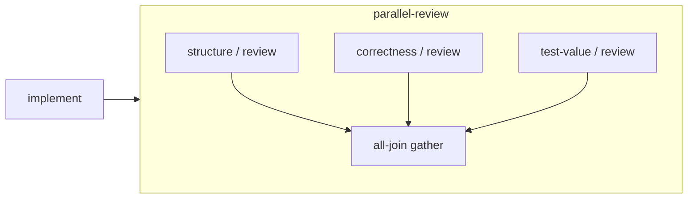

# 工作流组合示例

这些包演示结构继承、串行、并行与显式 all-join。完整命令和数据格式见[工作流定义手册](../../docs/WORKFLOW_DEFINITIONS.md)。基础安装即可检查／预览，无需模型密钥或服务。正式开发可[运行parallel-review并行分支或serial-review串并行分支](../../docs/USAGE.md#为正式任务冻结审查组合)；使用下方specialist-delivery可将两个专家分配给原工作单元，再承接总审查。kernel-delivery没有显式工作汇合，保持静态定义示例。

依赖顺序：

1. 导入 [kernel执行者](../agents/kernel-implementer/agent.json)、[结构审查者](../agents/architecture-reviewer/agent.json)、[正确性审查者](agents/correctness-reviewer/agent.json)、[测试价值审查者](agents/test-value-reviewer/agent.json)。
2. 导入 [structure-review](structure-review/workflow.json)、[correctness-review](correctness-review/workflow.json)、[test-value-review](test-value-review/workflow.json)。三者可单独预览。
3. 导入 [parallel-review](parallel-review/workflow.json)，引用三份子工作流并等待全部必需分支。
4. 需要前置结构审查时，导入 [serial-review](serial-review/workflow.json)，仍引用三份子模板，通过具名端口向两份后继传递结构审查产物。正式运行需显式`review_protocol: "dag-v1"`。
5. 导入 [kernel-delivery](kernel-delivery/workflow.json)，表达kernel实现结果传给总审查。

所有叶子继承当前结构路径全部材料；审查者不继承前驱kernel执行者的Skill。示例请求Codex与Claude Code，实际安装、能力、认证与权限由运行准入核验；覆盖后端按成员路径记录原因。工作流导入不会执行包内命令。示例专家提示仅为起点，尚无效果评价；正式并行审查必须逐成员通过原候选与收据检查，all-join不提供人工批准。

修改任何包应增加版本，刷新本地资源摘要、包digest及上层引用，再发布新的根。使用[示例grant](preview-grant.json)可查看全部10个结构实例及完整静态prompt；grant是预览输入，不是项目授权记录。正式交付仍须原六阶段与可信检查。

[review-requirements](review-requirements/workflow.json) 是独立的 WorkflowDefinition v2 示例：结构专家必需、测试价值专家建议，职责属于节点实例。导入相应 Agent 后可检查、预览、冻结和分享；[格式与命令](../../docs/WORKFLOW_DEFINITIONS.md#必需与建议审查的静态声明)说明边界。正式任务使用v3可信建议审查，或明确选择dag-v1进入v4；建议request-changes保留FAILED原回执，运行失败仍阻塞。已有v1示例及旧任务保持原身份。

使用`composition prepare-manifest`可一次保存整棵组合及全部资源，分享整个目录后直接`verify-manifest`；接收者用`prepare-from-manifest`准备所选叶子的完整输入。命令、权限与容量限制见[保存和分享完整组合](../../docs/WORKFLOW_DEFINITIONS.md#保存和分享完整组合)。

[specialist-work](specialist-work/workflow.json) 为实现和验证分别引用 [kernel-implementer](../agents/kernel-implementer/agent.json) 与 [validation-implementer](../agents/validation-implementer/agent.json)，用显式all-join覆盖两者。[specialist-delivery](specialist-delivery/workflow.json) 串接此工作子模板与parallel-review，适用于原unit一对一分配；导入validation专家、specialist-work，再导入specialist-delivery。完整选择、原unit依赖、显式可信容器与后端覆盖见[专长执行者运行说明](../../docs/WORKFLOW_DEFINITIONS.md#专长执行者与原工作单元)。静态预览不授予写权限；正式v5仍需原owner计划批准、可信检查与commit。训练实验另交原可信runner/gate，不从本开发示例推导训练已支持。

[prepared-delivery](prepared-delivery/workflow.json) 在原工作／审查选择外加入 [preparation-guide](preparation-guide/workflow.json)，引用可分别承担 inspector／planner 的独立 [development-preparer](agents/development-preparer/agent.json)。按 specialist-delivery 依赖、准备 Agent、preparation-guide、prepared-delivery 的顺序导入；正式 definition v4／input v8 的明确选择和完整材料门禁见[手册](../../docs/WORKFLOW_DEFINITIONS.md#盘点与规划的完整材料)。静态组提供继承，前两阶段的顺序和 inventory 结果仍由原六阶段负责；没有另一个图调度器。

[native-development](native-development/workflow.json) 再用一个普通父模板引用prepared-delivery，所有叶子完整继承父上下文。导入prepared-delivery后执行 `ergora composition import examples/composition/native-development`，再为native-development生成完整manifest。正式definition6／input10的 `composition.native` 选择 `root/development`，原inventory／plan／work／review路径相应移至此实例下；[完整使用说明](../../docs/USAGE.md#将六阶段作为一个子模板调用)解释预算准备、后端和原ID恢复。普通父只转发这一次调用；实际阶段调度、批准、candidate和证据沿原task所有者，不因静态图而另起账本。
