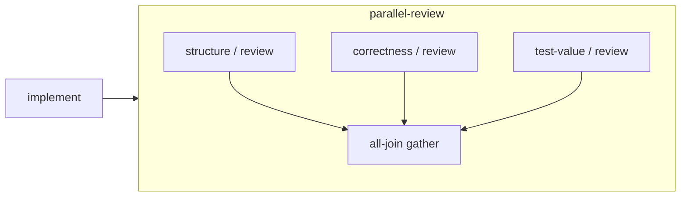

# 静态工作流组合示例

这些包演示结构继承、串行、并行与显式 all-join。完整命令和数据格式见[工作流定义手册](../../docs/WORKFLOW_DEFINITIONS.md)。基础安装即可检查／预览，无需模型密钥或服务；当前不会执行图。

依赖顺序：

1. 导入 [kernel执行者](../agents/kernel-implementer/agent.json)、[结构审查者](../agents/architecture-reviewer/agent.json)、[正确性审查者](agents/correctness-reviewer/agent.json)、[测试价值审查者](agents/test-value-reviewer/agent.json)。
2. 导入 [structure-review](structure-review/workflow.json)、[correctness-review](correctness-review/workflow.json)、[test-value-review](test-value-review/workflow.json)。三者可单独预览。
3. 导入 [parallel-review](parallel-review/workflow.json)，引用三份子工作流并等待全部必需分支。
4. 导入 [kernel-delivery](kernel-delivery/workflow.json)，表达kernel实现结果传给总审查。

所有叶子继承当前结构路径全部材料；审查者不继承前驱kernel执行者的Skill。示例请求Codex与Claude Code，真实运行的安装、能力、认证、批准与强制权限须由后续运行准入验证。工作流导入不会执行包内命令。示例专家提示仅为起点，尚无效果评价；all-join不提供可信批准。

修改任何包应增加版本，刷新本地资源摘要、包digest及上层引用，再发布新的根。使用[示例grant](preview-grant.json)可查看全部10个结构实例及完整静态prompt；grant是预览输入，不是项目授权记录。正式交付仍须原六阶段与可信检查。
